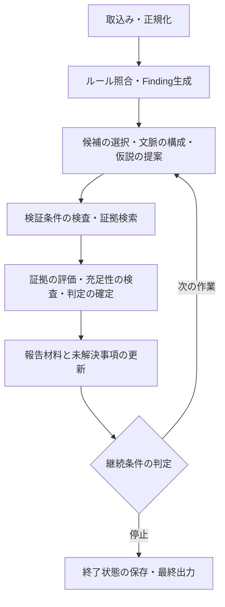

# 設計と開発

FORENSIAは、小型のローカルLLMが間違えたり、前の作業を忘れたりしても、証拠と調査の根拠を失わずに処理を続けるためのハーネスです。[README-ja.md](README-ja.md)では背景と設計原則を説明しています。この文書では、それを実装でどう支えているか、変更するときに何を守る必要があるかを説明します。

開発するのが人間でもAIでも、個々の機能を動かすだけでは不十分です。検索では対象のファイルを限定したのに、判定では別のファイルを根拠にしてしまう、といった不整合は、各機能の単体テストだけでは見落とします。証拠の取込みから報告まで、同じ対象と同じ検証条件を扱うことを優先します。

## 設計で大事にすること

LLMには、機械的に決めにくい提案を任せます。何を疑い、どの証拠を追加で調べ、どのように説明するかです。一方、その提案を実行してよいか、取得した証拠が条件を満たすか、正式な調査状態をどう更新するかはハーネスが管理します。プロンプトに「間違えないこと」と書くだけで、この分担を代替しません。

この分担は、複数のエージェントを動かすためのものではありません。単一モデルによる逐次実行を基本に、計画、検索、評価、報告の責務を分けます。モデルを強くすれば提案の質が上がる可能性はありますが、証拠の検査を省略してよくなるわけではありません。

正しさを保てるなら、保存する状態、同期する処理、モデル呼出し、設定項目が少ない構成を選びます。既存の責務に追加できる処理のために、第二のplannerや判定系、独立したメモリDBを作りません。LLMが生成した説明を、元の証拠と同じ資格の情報として次の処理へ渡さないことも、この単純さを保つ条件です。

ローカルで完結できることは設計上の要件です。依存関係とモデルを準備した後の調査に、外部検索やクラウドサービスを必須としません。外部のLLM接続先を選べば、プロンプトに含まれる証拠由来の情報はそこへ送信されます。Traceにも送信本文と応答を保存するため、ケース全体を証拠と同様に取り扱います。

## 調査の流れ

一回の調査は、取得済みのアーティファクトを読み込み、ルールから手がかりを見つけた後、仮説の生成と検証を繰り返します。全体の組立ては[pipeline.py](src/forensia/pipeline.py)、調査ループは[investigator.py](src/forensia/investigation/investigator.py)が担当します。



### 取込みで、後から根拠をたどれるようにする

MFT、EVTX、Prefetch、Registryを既存のパーサーで読み、証拠種別ごとのテーブルへ正規化します。証拠行にはEvidence IDを持たせ、取込み元、パーサー、内容の識別情報と関連付けます。`raw/`に保存するJSONLはパーサーの出力であり、取得した原本の代わりにはなりません。原本はケース外で保全します。

この段階では、読めたレコード数と、調査に必要な証拠が揃ったかを分けます。例えばEVTXを正常に取り込めても、必要なchannelやproviderが含まれているとは限りません。利用できる証拠種別と検証能力をCoverageとして記録し、後続の検索や判定で参照します。

取込み・正規化・ルール実行には、入力と処理のrevision、実行結果を記録します。再開時は保存済みの記録を確認し、入力が変わっていないのにすべてを無条件でやり直すことを避けます。

### ルールの一致を、調査の手がかりにする

正規化した証拠へSigmaと独自のSQLルールを適用し、Findingを作ります。Findingは「このルールに一致する観測がある」という調査の起点です。攻撃や不正が成立したという結論にはしません。

EVTXの意味付けにはevent IDだけでなくchannelとproviderを使います。同じ番号でも出所が異なれば、同じ活動を表すとは限らないためです。既知の対応を持たないレコードも閲覧できますが、番号だけから既知の活動へ分類しません。

大量のFindingがある場合は、証拠種別とルールごとに候補の提示機会を配分します。元のEvidence、host、時刻、entityへの参照は残し、一度にすべてをLLMへ渡しません。未解決のGapやTaskも同じ作業選択で扱い、目立つFindingだけを調べ続けないようにします。

### 仮説を、検索と照合できる条件にする

選んだ候補と利用可能な証拠から、LLMに仮説を提案させます。受け入れる前に、既存の条件形式で検証できるか、必要な項目が証拠にあるか、要求した件数を満たし得るかを検査します。受け入れられない提案には理由を返し、限られた回数だけ修正させます。

明示された質問は調査開始時にGapとして登録し、一般のFindingより先に選択します。探索モデルは質問を対象範囲と要求項目からなる契約として解釈し、その契約に沿うSELECTを提案します。ホストは対象範囲をSQLへ適用し、正規化済み原本のIDを記録します。SQLの訂正時も契約は固定し、質問・Gap・契約・探索段階をTrace上で結び付けます。候補行は調査対象の提示であり、質問への回答や不存在の根拠ではありません。SQLの実行時に型変換などが失敗した場合は、SQLと理由を既存の訂正予算内でモデルへ返します。DB接続やI/O、割込みなどの障害はSQLの訂正対象にしません。

この探索経路の契約は単一の証拠種別で表現できる要求に限り、生成スキーマも同じ制約を持ちます。複数種別が必要な要求を、一部の項目を捨てて解決済みとして扱いません。検証済みの契約でSQLを訂正するときは、モデルには`action`だけを返させ、契約はホストが保持・適用します。契約自体が未検証の場合は、既存の訂正枠で契約の修正も受け付けます。

対象範囲の文字列は質問中の値と照合し、日時列では明示された日時や日付境界と整合するかを検索前に検査します。質問にないパスや日付を補って対象を狭める契約は拒否します。オフセット付き日時をUTCの`TIMESTAMP`列と比較するときはUTCへ正規化し、探索と後続の範囲確認で同じ値を使います。現地時刻をオフセットなしでUTC列へ比較する契約は拒否し、暦日を保存する`DATE`列と区別します。この検査だけで、モデルが質問の意味を正しく解釈したとは保証しません。

ディレクトリ配下の指定には、対応する列を証拠種別のスキーマで宣言したうえで`path_under`を使います。パス要素の境界で照合し、似たディレクトリ名やファイル名の一部を一致としません。`equals`は完全一致のままとし、検索結果に合わせて別の演算子へ置き換えません。

質問の対象範囲を解析するときは、注入した`section_instructions`の共通説明を除外し、当該質問の本文とヒントを使います。モデルへ渡す文脈や、識別子・Traceに保存する原文は保持します。

単一テーブルの行を返す探索SQLには、ホストが原本のID列を追加します。フィルタ・並び順・LIMITは維持し、集約・DISTINCT・結合など、IDの追加で行の意味が変わり得る検索は書き換えません。原本へ追跡できない結果は拒否します。

質問の調査に採用した探索で取得した行は、モデルへ提示した少数の例だけに縮めず、未評価の検索候補として別表に残します。候補は保存済みの探索段階と契約へ結び付け、現在の原本と対象範囲を再確認して投影します。JSON、候補CSV、本文の候補表には証拠IDと探索段階のIDを残します。候補の追加によって回答状態を引き上げず、Assessmentを通った回答・観測と区別します。本文の表示上限を超える行も構造化出力には保存します。

検証条件を表す`VerificationSpec`は、支持・反証の条件、対象範囲、必要な証拠能力、相関条件などを持ちます。後続の検索と判定はこの条件を使います。自由文の説明だけを比較して、同じ仮説かどうかを判断しません。

MFT・Prefetch・Registryの型付き観測では、モデルは条件を返し、表示文はホストが生成します。明示質問ではEVTXの正規化済み原本フィールドも型付き観測で確認できます。これは指定フィールドの値の確認に限り、イベントの意味づけや相関条件には既存の検証条件を使います。例えば「このファイルの削除フラグが立っている」という観測を、「利用者が意図的に証拠を消した」という解釈へ拡張して確定させません。条件で表せない解釈は未解決として残します。
有限個の対象に対する反証は、全対象に現在の反証Assessmentがあり、各原本の値が支持条件を満たさない場合に限ります。ゼロ件から不存在を結論しません。

### 条件で決まる検索はホストが組み立てる

型付き観測の最初の検索は、ホストが条件と一致するEvidence IDを選び、許可されたSELECTとして実行します。条件を満たすかの比較にはAssessmentと同じ処理を使います。件数上限は一致した証拠に適用し、テーブルの先頭を見ただけで不一致とはしません。

追加検索では、LLMに目的、対象table、SQLまたは既存recipeと引数を提案させます。現在の検証条件と利用可能な証拠に対応するschemaやrecipeを開示し、提案された検索をホストが検証・制限して実行します。モデルへ自由なshellやPythonの実行権限は与えません。

反証や別の説明を考える指示も、この提案と評価の中に含めます。ただし、何でも反論させることが目的ではありません。元の対象・期間・命題を保ち、説明を区別できる検索を求めます。悪意を主張していない観測に悪意の証明を要求したり、反証が見つからなかったことを確定の根拠にしたりしません。

## 永続化と検証の契約

### 調査の正本は一つのDuckDB

Evidence、Case State、Trace Stateは、ケース内の`db/case.duckdb`へ保存します。EvidenceとCase Stateは`main`、Trace Stateは`trace`スキーマに置き、関連する更新を同じトランザクションで扱います。論理的な役割の違いを、別々のデータベースへ分ける理由にはしません。

| 概念 | 記録すること |
|---|---|
| Evidence | 正規化した証拠と原本への参照 |
| Finding | ルールに一致した観測と関連Evidence |
| Hypothesis | 検証する命題、条件、現在の判定 |
| Task | 実行すべき作業、依存する条件、再試行条件 |
| Gap | 未解決の問いや不足している証拠 |
| Claim | 報告書で扱う主張と、その根拠への対応 |

Traceには検索、評価、モデルの入出力、状態遷移、操作の受付と結果を記録します。過去の判断を残す一方、実行中から終了へ更新するライフサイクル行もあるため、DB全体を単純な追記ログとは扱いません。

Working Stateは、このCase/Traceから現在の作業に必要な情報を組み立てた一時的な文脈です。Markdownの要約を読み直して状態を復元したり、要約専用の正本を持ったりしません。旧ケースの`memory/`には人のメモが残っている可能性があるため、利用していないことを理由に削除もしません。

### 実行の成功と、仮説の成立を分ける

検索が成功したこと、証拠が条件に一致したこと、結論を確定してよいことは、それぞれ別の判断です。検証は次の順序で行います。

| 段階 | 確認すること | 責務の所在 |
|---|---|---|
| VerificationSpec | 何を、どの範囲・条件で検証するか | [検証条件](src/forensia/core/verification.py) |
| Receipt | 何を実行し、何件取得でき、どのEvidenceを参照できるか | [検索の実行](src/forensia/investigation/hypotheses/execution.py) |
| Assessment | どの証拠の組が条件を満たし、支持・反証・参考情報になるか | [証拠評価](src/forensia/investigation/verification/assessment.py) |
| Sufficiency | 根拠の独立性、Coverage、相関などを考慮して十分な支持があるか | [充足性](src/forensia/investigation/verification/sufficiency.py) |
| Settlement | 検査結果を踏まえ、正式な判定へ移行できるか | [判定の確定](src/forensia/investigation/verification/settlement.py) |

Assessmentへ渡す前に、検索結果のEvidence IDから正規化済みの行を取得し直します。SQLが作った別名や定数、LLMが選んだサンプルを証拠の正本にしません。取得した行数と引用可能な行数も区別します。

証拠が何行あるかだけで独立性を判断しません。例えば、一つのPrefetchに記録された複数の実行時刻は同じ原本からの派生です。別々の独立証拠として数えず、参照元と派生関係を使って評価します。

型付き観測は、条件との照合と必要な検査が成立すれば、LLMの再承認なしで共通のSettlementを通して確定できます。LLMの判定がある場合も、それは提案です。正式なverdictはSettlementが管理し、SufficiencyやReport Engineが独自に確定しません。

### 検索・判定・表示で同じ対象を保つ

観測候補から作った条件には、ホストがその候補のEvidence IDを結び付けます。「このファイルが削除状態か」を調べるとき、別の削除済みファイルが一致しても代用できません。検索、Assessment、仮説の表示、条件の識別に同じ対象を使います。

時刻にも同じ注意が必要です。MFTの`si_modified`と`fn_modified`は異なるフィールドです。提案された`equals`条件の値が対象フィールドと一致せず、提示した別フィールドの時刻に一致する場合は、検索前に回数を限って修正させます。両フィールドが同じ時刻である場合や、別フィールドの時刻を`greater_than`条件の閾値に使う場合は、この取り違えには当たりません。

判定をタイムラインへ載せる際も、原本の検証対象列の時刻を使います。削除フラグなど、対応する活動時刻を検証していない観測には、別の時刻列を代用しません。

型や件数の解釈も共通にします。`is_deleted`のようなBoolean列はJSONの`true`/`false`で評価し、文字列や数値を都合よく変換しません。`min_count`は異なるEvidence IDの数であり、同じ原本から作った時系列行の数ではありません。対象数を超える要求は検索前に拒否します。

### 0件と、観測できないことを区別する

検索が0件でも、必要なログが取得されていない、対象期間が欠けている、検索が途中で打ち切られた、といった可能性があります。取得結果とCoverageを照合し、その範囲で「存在しない」と判断できる条件が揃っているかを確認します。単に何も返らなかったことだけで支持や反証へ進めません。

観測不能な要求や満たせない条件は、仮説の反証とは別に扱います。証拠の追加で再評価できるのか、条件自体を人が見直す必要があるのかを理由とともにGap/Taskへ残します。

### 証拠が変われば、古い支持も見直す

Assessmentと根拠リンクには、証拠内容と検証条件の識別情報を残します。sourceが置き換わった場合、IDが同じというだけで過去の支持を再利用しません。[invalidation.py](src/forensia/evidence/invalidation.py)が影響を受けた仮説とClaimを再確認が必要な状態へ戻し、報告節を失効させます。過去の根拠リンクは履歴として保持し、現在の証拠から再評価します。

証拠の追加・置換では、標準のMarkdown・HTML・検査JSONも失効させてから再出力します。失敗時に古い成果物を最新の結果として残しません。失効した節の本文はDBに保持し、現在の報告書から除外します。入力の`FORENSIA.md`・`REPORT.md`や独自の出力先とは区別します。

## 小型モデルで調査を続ける工夫

### 作業に合わせて文脈を組み立てる

各呼出しに、現在の仮説、関連するEvidence、未完了の作業、過去の試行、利用できる検索を渡します。すべてのテーブル、ルール、会話を毎回並べることはしません。[working_state.py](src/forensia/investigation/working_state.py)が調査状態を、[context/](src/forensia/context/)がschema・recipe・playbookなどの共通資料を構成します。

長い配列は代表値だけでなく、総数と省略数も示します。モデルが見た一部を証拠全体と誤認しないようにし、完全な値はEvidenceから取得できるようにします。予算調整前に選んだ資料と、実際の送信本文に残った資料も別に記録します。

コンテキスト上限は接続先に合わせて設定し、出力用の予約も含めて入力を制限します。上限を自動検出したとは扱いません。縮約は送信文脈を小さくする処理であり、元の証拠や履歴を書き換える処理ではありません。

### 修正の機会を与え、同じ失敗で止まり続けない

モデル応答は構造化したschemaで受け取り、形式と内容を検査します。同じschemaをAPIのresponse formatだけでなく先頭のsystem messageにも明示し、モデルが生成時に参照できるようにします。schemaを受け付けない、またはコンパイルできないサーバーには制約を外して再送せず、理由を記録してその呼出しを失敗させます。サーバーが生成済みの出力を解析できなかった場合は、同じschemaを保ち、JSONだけを返す指示を追加して既存の修正枠で再試行します。候補生成や一つの検索計画では、この再試行、JSONの修復、文脈の縮約、意味上の修正が初回生成後の一つの修正枠を共有します。各層が独立に再試行して、呼出し数が増え続ける構造を避けます。

修正しても使えない提案は理由を保存し、他の作業へ移ります。探索結果が0件の場合も、修正枠が残っていれば、検証済みの要求を保った別の検索を1回だけ提案させます。同じSQLの再実行は止め、0件を不存在の証明にはしません。値の取得を求める質問では、指定された列の実値、または配列の実要素を確認し、範囲比較や部分文字列の条件への置換を拒否します。比較条件を明示した質問では、その演算子と値を維持します。過去の検索についても、条件・証拠状態・検索内容の識別情報を照合し、同じ試行を制限します。証拠や方針が変われば再評価できますが、再開しただけで失敗履歴を忘れたことにはしません。

通信断や接続タイムアウトでは、設定された待機時間の範囲で復旧を待ち、同じリクエストを再送します。応答の読取りタイムアウトでは復旧待機後に一度だけ同じ要求を再送し、再び応答期限を超えたら、その要求の失敗として理由を保存します。外側の復旧処理で同じ要求を再開せず、次の調査対象へ進めます。JSON修復中も修復対象を保持し、通信障害を理由に提案の修正枠を消費しません。待機上限や停止指示では待機を終了します。文脈上限の超過は通信障害と区別し、入力を変更せず送り続けません。LLMの論理呼出しとproviderへの実送信attemptを分け、再送の理由とコストを記録します。

要求された観測値が取得行に存在しない場合は、回答生成を呼ばず未解決として記録し、他の作業へ進みます。同じ入力の再選択は抑止し、証拠や方針が変われば再評価します。別の列の値を要求値の代わりには使いません。

### 文章量や呼出し回数を進捗にしない

進捗の判断には、保存された証拠とCoverage、未解決作業、評価済みの観測や矛盾の変化を使います。モデルのconfidenceが上がった、文章が長くなった、検索を何度も実行した、といった変化だけでは停滞を解消したと数えません。

実行可能な作業がなくなった場合や、無進捗・サイクル数・呼出し予算の条件に達した場合は停止します。LLMの呼出し上限が無制限でも、他の停止条件は有効です。未解決事項は理由と再試行条件を保存するため、停止を「すべて解決した」と表示しません。

## 報告書は調査結果から組み立てる

Report Engineは、採用した報告書仕様と現在のCase/Evidenceから表や構造化回答を作ります。検索条件、参照元、結果の識別情報を記録し、材料をDBへ保存してから、必要な箇所だけLLMで文章化します。変更した節につき文章化は最大1回とし、失敗や予算切れでも保存した材料を利用できます。

質問本文・見出し・テンプレート本文は、節とブロックを含む識別子でReport Gapへ渡します。質問の自然文を対象範囲と要求項目へ分解する処理はモデルに依存し、生成した契約は探索と回答の間で固定します。回答投影は、正確な質問・Gap・契約・採用仮説・検証仕様に結び付いたTraceのadmission receiptを照合し、そのreceiptが返した対象IDのうち、現在も有効な評価済みEvidenceだけを使います。`source_gap_id`だけで質問との関連を示す観測は回答に含めません。観測が要求の一部だけを裏付ける場合は部分回答とし、未検証の要求項目を満たしたものとして扱いません。JSONには質問原文・Gap ID・Evidenceを、回答行とCSVには検証結果・Evidence ID・query IDを残します。MFTの名称不一致やRecent LNKの時刻の近さから、改名やその方向を推測する処理も行いません。

質問が未解決の間は、関連する行を観測として示し、質問への確定回答と区別します。ある列の値を確認できても、その行が質問の対象であることまで保証したとは扱いません。同じEvidence IDは1行にまとめ、複数の検索で得た場合も出典クエリをすべて保持します。

全タイムスタンプの取得を明示した質問では、正規化済み原本の列型、アーティファクトのスキーマにある`timestamp_array_fields`宣言、型付き観測カタログから必要な日時項目を確認します。モデルの要求から漏れた項目も原本の値で補い、値や配列の分類宣言が不足する場合はGapを未解決、回答を部分回答として理由を残します。特定の時刻だけを求める質問には、全日時項目の取得を強制しません。

未確認のモデル本文は、検査結果とともに`section_runs`の`narrative-draft`へ保存し、公開本文には掲載しません。引用IDや形式の検査だけでは文章の意味の正しさを保証できないためです。公開本文は保存した調査結果と表から組み立てます。Claimの根拠は確定した仮説と現在有効なEvidenceLinkから導き、文章中に登場したIDだけで根拠の対応を上書きしません。

報告書から不足する証拠や未解決の問いが見つかれば、調査側の既存のGap/Task受付へ渡します。Report Engineが別のplannerや検証ループを持って解決することはありません。文章の体裁や引用形式の問題は報告書の診断として扱い、証拠不足と混同しません。

通信例外などの実行障害の詳細はTraceに保存します。報告書や調査モデルの入力には例外本文を転記せず、型付きの実行結果から未解決の状態を投影します。証拠不足の理由と実行障害を区別し、公開検査の証拠要件は緩めません。

Markdown、HTML、JSON、CSVは再生成できる出力です。報告書の完成、調査の終了、個々の仮説の判定、公開検査の結果は分けて表示します。引用IDが実在することを検査できても、その文章が証拠の意味を正しく説明したことまでは保証できません。

時刻の表示でも、処理の都合を証拠へ持ち込みません。システムの処理時刻はUTCで記録しますが、証拠の時刻基準は別に扱います。現地時間での絞り込みに必要な基準が不明なら、実行当日のUTC差や既知の参照回答で補わず、理由付きの部分回答として残します。ユーザーが書いた報告書仕様の本文は自動翻訳しません。

## Runtimeと画面の責務

一つのケースの書込みは一つの実行所有者に限定します。通常起動、バックグラウンド起動、再接続は同じRuntimeを使い、CLIとTUIはそこへ操作を渡します。同期Python APIも、同じwriter lockと調査・検証・報告の処理を通ります。UIを増やしても、独自の判定や状態更新を実装しません。

`/detach`は画面だけを閉じ、`/stop`は調査だけを止めます。`/quit`と`Ctrl+Q`は停止を要求し、処理が落ち着いてから調査プロセスも終了します。待機期限までに終了を確認できなければ画面を残し、`/kill`による強制終了を案内します。強制終了はLLMの応答やDBロックを待たずに所有プロセスを終了し、処理中の作業は次回起動時に異常終了として扱います。終了の確認にはケースの所有ロックの解放を使い、データは削除しません。

停止や追加指示は、受付と適用を別々に記録し、安全な処理境界で反映します。同じcommand IDの再送には保存済みの結果を返し、操作を二重に適用しません。同期HTTPの応答待ちは直ちに中断できないため、停止を受け付けただけで完了表示にはしません。

終了時は、sessionの終端記録を先に保存してから最終的な報告材料を更新します。表示用の更新が失敗しても、終了した調査を実行中のまま残さないためです。異常終了からの復旧でも、取得できなかったproviderの結果や完了時刻は不明のまま区別します。

画面はDBの確定済み状態を読取り専用スナップショットで参照し、独自の正本を持ちません。一時的に読取りできない場合は最後の表示と更新時刻を保持し、その状態を知らせます。接続が失われた場合とDBの一時的な読取り失敗も区別します。LLM使用量は実測・推定・不明を分け、ログの色や失敗判定にはイベントが明示したseverityを使います。

IPCは同一マシン内に限定し、POSIXではUnix domain socket、Windowsではnamed pipeを使います。HTTP API、外部メッセージブローカー、複数利用者向けの共有サービスを前提にしません。責務の所在は[runtime/](src/forensia/runtime/)、状態の表示は[db/views.py](src/forensia/db/views.py)と[tui.py](src/forensia/tui.py)です。

## Markdown入力

利用者が与える方針、報告書の要件、参考知識は役割を分けます。いずれもEvidenceや実行許可にはならず、検索と判定の検査を迂回できません。

| 入力 | 役割 | 採用方法 |
|---|---|---|
| `FORENSIA.md` | 調査目的、範囲、優先順位、注意事項 | 新規調査の`--system-prompt`、ケースルートのファイル、内蔵方針 |
| `REPORT.md` | 報告書の節、問い、出力方針 | 新規調査の`--template`、ケースルートのファイル、同梱テンプレート |
| KnowledgeのMarkdown | 作業に関連する参考知識 | Python APIの`knowledge_dir`。公開CLIのオプションではない |

### 調査方針と報告書仕様

調査方針は本文全体を各roleの指示に使います。`Objective`直下の最初の段落は調査目的の受付にも使い、なければ`Scope`を使います。例えば次のように目的と制約を分けます。

```markdown
# Investigation policy

## Objective
提供された証拠から活動を再構成し、調査上の問いに根拠を添えて答える。

## Constraints
観測された活動と意図の解釈を分け、判定できない理由を残す。
```

報告書仕様では`#`が節、`##`が節内のblockです。frontmatterの`instructions`は全節へ適用されます。節冒頭の本文も、その節の各blockへ共通条件として渡します。質問の識別にはこれらの条件を含めるため、条件を変更した質問へ以前の結果を流用しません。既存の表や質問への回答を使う場合は、見出しの言い回しに依存させず、builderやkeypointを明示します。

```markdown
---
instructions: 証拠参照を示し、観測と解釈を区別する。
---
# 調査結果

## 主な所見
<!-- mode: table; builder: overview_key_findings -->

# 未解決事項

## 残る調査作業
<!-- mode: table; builder: gaps_unresolved -->
```

節のkeyは見出しの順序と文字列から決まります。正規化後に重複する見出しや最初の節より前の本文は受け入れません。利用できるhintは[template_parsing.py](src/forensia/report/sections/template_parsing.py)、実例は[同梱テンプレート](src/forensia/data/report/)を参照してください。`examples/`はGit管理外のローカル入力用ディレクトリで、チェックアウトには含まれません。

方針と報告書仕様は、採用した内容とrevisionをTraceへ保存します。明示指定なしの再開では保存済みの内容を使うため、元ファイルを編集しただけで実行中の調査は変わりません。明示的な再採用やsteeringも既存の受付を通し、変更していない方針の節や未解決作業を保持します。詳細は[case_policy.py](src/forensia/investigation/case_policy.py)と[report_input.py](src/forensia/report/sections/report_input.py)が管理します。

### 必要な知識だけを選択する

Knowledgeは`type: knowledge`、`title`、`description`、`tags`をfrontmatterに持つMarkdownです。[knowledge.sample/](knowledge.sample/)に例があります。tagと検索語から関連する文書・節を決定論的に選び、振り分け用のLLM呼出しを追加せず、文脈の予算内で渡します。

一つの文書に一つの話題を置き、`##`単位で読んでも必要な前提が分かるようにします。節がある文書では冒頭の本文を一緒に渡さないため、必須の前提はdescriptionか各節へ書きます。Knowledge本文は遅延読込みされ、方針・報告書仕様と同じrevision保存ではありません。再現性を調べる実験中に入力を変更しないでください。

## ルールと拡張点

event ID、ツール名、証拠種別ごとの意味、編集可能な判定方針は、汎用Pythonの分岐へ埋め込まず宣言として管理します。特定の評価ケースの正解を追加することと、一般に使える観測・検証能力を追加することを区別します。

| 追加・変更するもの | 既存の拡張先 |
|---|---|
| アーティファクト種別 | [ArtifactAdapter](src/forensia/evidence/artifacts.py)、parser/normalizer、Coverage、source置換 |
| SQLルールと仮説の条件 | [data/rules/](src/forensia/data/rules/)、[ルールモデル](src/forensia/knowledge/rules/models.py) |
| フィールド、capability、検証の語彙 | [data/schema/](src/forensia/data/schema/) |
| 構造化した質問と回答 | [question_routing.yaml](src/forensia/data/schema/question_routing.yaml)、[answer_registry.py](src/forensia/report/answers/answer_registry.py) |
| 報告書の表と品質検査 | [table_registry.py](src/forensia/report/answers/table_registry.py)、[quality_gates.py](src/forensia/report/sections/quality_gates.py) |

新しい証拠種別なら、読めることだけでなく、Evidence参照、Coverage、置換後の失効、検索と報告まで接続します。新しい回答builderにも、対象範囲と質問本文の条件を渡し、証拠参照を残します。既存の拡張を通る例は[tests/test_extension_points.py](tests/test_extension_points.py)にあります。

SQLルールには`confirm_when`、`refute_when`、`evidence_requirements`を宣言でき、仮説の受付時に既存のVerificationSpecへ変換します。抑制はケースの`allowlist.yaml`でルールIDと証拠行を照合し、Findingや証拠を削除せず適用します。ルールを実行して0件だった状態と、対象telemetryがなく実行しなかった`not_observed`も区別します。

### Sigmaを取得・変換してケースへ固定する

Sigmaルールはwheel・sdistへ同梱しません。`setup`は[setup.py](src/forensia/knowledge/sigma/setup.py)のrevisionとSHA-256で固定したSigmaHQのアーカイブを取得し、既存の変換・検証契約でbundleを作ります。保存先は`$XDG_DATA_HOME/forensia/sigma/<version>/`（未指定時は`~/.local/share/forensia/sigma/<version>/`）です。`investigate`で未導入なら、Runtimeを起動する前に取得・変換を済ませます。失敗時は不完全なbundleを導入せず、ケースを上書きしません。

```bash
uv sync --locked
uv run forensia setup
uv run forensia investigate ./input --out ./case001 --rules ./local-rules
```

変換、SQLの実行検査、fixture検証は別々に記録します。変換できたことは検出の正しさを意味しません。fixtureがない`absent`や対象が異なる`not_applicable`も、fixtureで検証済みとは数えません。原本ルール数とtarget binding数を分け、失敗は理由付きで採用から除外します。

`--rules`はSigma YAMLファイル、ルールディレクトリ、SigmaHQのチェックアウトを受け付け、ネット接続なしで変換・検証します。調査ごとに指定したルールは既定のインストールを変更しません。`setup --rules <path>`はローカルのルールを既定値として導入します。Python APIも`run_investigation(..., rules=<path>)`で同じ入力を受けます。ケースが採用したbundle全体はDuckDBの`trace.investigation_steps`（phase=`sigma-rules`）へ保存し、再開・証拠追加・報告時に使います。キャッシュや元のYAMLの変更を再開へ反映しません。

対応付けは[sigma.yaml](src/forensia/data/schema/sigma.yaml)、変換は[converter.py](src/forensia/knowledge/sigma/converter.py)、検証は[validation.py](src/forensia/knowledge/sigma/validation.py)を変更します。ライセンス通知と原本のauthor/source参照を保持し、報告書へ著者・出典を省略せず投影します。取得したSigmaHQルールには[DRL 1.1](https://github.com/SigmaHQ/Detection-Rule-License)が適用されます。テスト用の上流bundleとライセンスは`tests/fixtures/sigma/`に置き、sdist・wheelから除外します。

## 実装の配置

概念ごとの責務を次の場所へ集約します。詳細な列、型、許可条件は実装上の契約を参照し、この文書に別の仕様一覧を作りません。

| 場所 | 責務 |
|---|---|
| [core/](src/forensia/core/)、[db/](src/forensia/db/)、[config.py](src/forensia/config.py) | 基本モデル、保存契約、状態へのアクセス、設定 |
| [evidence/](src/forensia/evidence/) | 取込み、正規化、識別、根拠リンク、無効化 |
| [knowledge/](src/forensia/knowledge/)、[data/](src/forensia/data/) | ルールと宣言、Coverage、参考知識 |
| [llm/](src/forensia/llm/)、[context/](src/forensia/context/) | モデル通信と応答契約、文脈の構成と予算、使用量の記録 |
| [report/](src/forensia/report/) | 報告材料と構造化回答、Claim、節の保存、出力と検査 |
| [investigation/](src/forensia/investigation/) | 作業選択、仮説と検証、判定の確定、調査の継続と終了 |
| [pipeline.py](src/forensia/pipeline.py) | 取込みから報告までの組立て、同期Python API |
| [runtime/](src/forensia/runtime/) | 実行所有者、IPC、操作の受付と適用 |
| [cli/](src/forensia/cli/)、[tui.py](src/forensia/tui.py) | 利用者からの入力と状態の表示 |

表は下位層から上位層の順です。上位層は下位層を使えますが、例えばreportからinvestigationの判定を呼ぶような逆方向の依存は作りません。[scripts/check_imports.py](scripts/check_imports.py)がこの方向を検査します。両方から必要な文脈生成をcontextへ置いても、調査判断まで共有処理へ移す理由にはなりません。

スキーマは[db/schema.py](src/forensia/db/schema.py)、モデル応答は[llm/schemas.py](src/forensia/llm/schemas.py)、作業の検証可能性と再試行条件は[work_judgment.py](src/forensia/investigation/work_judgment.py)を確認してください。同じ概念を変更する場合は、保存・検索・判定・表示の利用箇所を一緒に更新します。

このリポジトリは最新仕様を対象とします。内部APIや設定名を意図的に変更するとき、旧名のaliasや二重の処理を互換性のためだけに残しません。永続化の互換性が変わる場合はschema versionと利用箇所を揃え、古いケースを自動で修復・移行せず保全します。新規取込みが必要なら別のケースを使います。

## 評価

テストで確認するのは、証拠の保存、検索の制限、判定の一貫性、終了状態などのソフトウェアの契約です。調査が役に立ったかは、実際の証拠と問いを使って別に評価します。狭い観測のconfirmed件数や、構造化回答の`answered`件数を、そのまま正答数としません。

[BENCHMARK.md](BENCHMARK.md)にCFReDSの問いと参照回答を置きます。参照回答や後続の判定を、調査側の方針、Knowledge、報告書入力に混ぜません。比較では入力証拠、コード・モデル・設定、指示、予算を揃え、有用な追加検索、根拠のある結論、見落とし、誤確定、未解決事項とコストを照合します。

実行中のケースや元の評価結果を直接変更せず、終了状態を確認して凍結したコピーを使います。[scripts/eval/run.py](scripts/eval/run.py)はCase/Traceを読取り専用で集計します。出力はケース外へ保存してください。

```bash
uv run python scripts/eval/run.py ./case-copy --output ./evaluation.json
uv run python scripts/eval/run.py ./baseline-copy ./after-copy --output ./comparison.json
```

モデル使用量の実測・推定・不明、論理呼出し・実送信、検索提案・実行・Assessment到達を分けて読みます。送信内容はprovider attemptのrequest本文で確認します。未計測の値を0に置き換えたり、検索回数の増加だけを改善としたりしません。変化がモデルのばらつきで説明できる場合は、条件を揃えた再試行が必要です。

[refutation.py](scripts/eval/refutation.py)は、未確認の解釈に対して追加の反証指示を与える比較実験です。少なくとも2つの証拠種別を含む4候補について、問い、観測Evidence ID、既存形式の仮説を人が固定します。`candidates.json`は`question`、`evidence_ids`、`hypothesis`を持つ4要素の配列です。

```bash
uv run python -m scripts.eval.refutation prepare ./case-copy ./candidates.json ./refutation-eval
uv run python -m scripts.eval.refutation run ./refutation-eval
```

準備では証拠・provenance・Coverageだけをコピーし、過去の仮説や報告を除きます。コード・設定・入力の一致を検査し、各条件は既存の検証処理で追加検索1回、planner修正1回、結果評価1回までとします。再実行は全4組を新しいラウンドで繰り返し、成功例だけを選びません。現在の通常指示にも反証の検討が含まれるため、過去の「指示なし／あり」と同じ比較には当時のコードが必要です。

## 開発の手順

### CLIと設定

Python 3.14以降と[uv](https://docs.astral.sh/uv/)を使い、`uv sync --locked`で開発依存を揃えます。`.env.example`を`.env`へコピーし、`/v1`を含まない`LLM_BASE_URL`とロード済みの`LLM_MODEL`を設定します。認証が必要なら`LLM_API_KEY`を指定します。設定は実行開始時に検証し、APIキーをCase/Traceへ保存しません。

```bash
uv run forensia investigate ./input --out ./case001 \
  --system-prompt ./FORENSIA.md --template ./REPORT.md
uv run forensia attach ./case001
```

通常起動はRuntimeへTUIを接続し、`--background`はRuntimeだけを起動します。既存ケースの閲覧や操作には`attach`を使います。TUIの`/resume`は再開、`/stop`は安全な境界で停止、`/detach`は画面だけを閉じる操作です。`/quit`と`Ctrl+Q`は調査プロセスも終了し、停止待ちを打ち切るには`/kill`を使います。`/add <input_dir>`で証拠を追加し、`/report`は採用済みの節を出力、`/report --write`は節を更新します。詳細は`--help`、TUIの`/help`、[.env.example](.env.example)を参照してください。

TUIのLLM欄にはRuntimeの接続先URL・モデルと、同じ接続先・モデルの通信記録から得た最新の状態・時刻を表示します。`Last I/O`は最終通信の観測結果です。Runtimeがない場合はケースに保存された接続情報を表示します。

`--overwrite`はケースディレクトリ全体を削除して作り直します。原本と再利用する入力文書は必ずケース外へ置き、停止済みのケースにだけ使ってください。実行中・操作適用中のケース、入力と出力の重なりなどは削除前に拒否します。調査結果を確認するためだけに再開・上書きしません。

### 検証と変更の提出

コード変更時は、変更した利用経路を確認した後、以下を実行します。文書だけの変更ではリンク・用語・実装との一致を確認します。

```bash
uv run pytest tests/ -q
uv run ruff check src tests scripts
uv run ruff format --check src tests scripts
uv run python scripts/check_imports.py
uv run python scripts/audit_schema_coverage.py --strict
uv run python scripts/regenerate_playbook.py --check
uv run python -m forensia.cli.doctor
```

pytestはオフラインで使い捨てのケースへ実行し、モデル境界をmockして実際の保存・CLI・生成物を確認します。既存のテストを優先して更新し、Evidence/provenance、判定、失効、実行上限、停止・再開などの不変条件を守ります。内部の呼出し順や文章の完全一致のために、製品コードを複雑にしません。doctorは配布物の宣言・テンプレート・保存契約の確認であり、開発時の全テストの代替ではありません。

変更の説明には、解決する問題、変更後の挙動、確認した経路、残る制約を記載します。READMEは利用者へ目的と全体像を、この文書は設計判断と責務を説明します。進行中の作業と実験の経過はTASKS、過去の変更はgit履歴へ残し、この文書を実行記録の一覧にしません。
