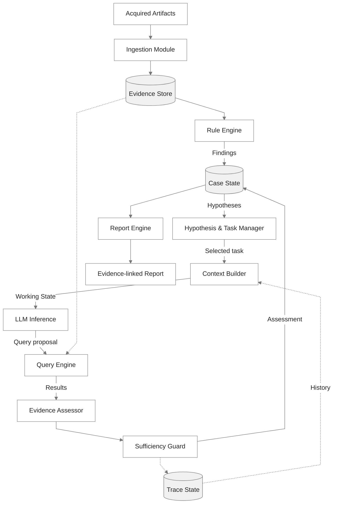

# FORENSIA


[English](README.md)

FORENSIAは、LLMを用いてWindowsデジタルフォレンジックを支援する、実験的なハーネスです。

MFT、EVTX、Prefetch、Registryなどの各種アーティファクトを取り込み、検知ルールによる発見を起点として、**調査仮説の生成、証拠の検索と検証、報告書の更新**を繰り返します。

このプロジェクトのコンセプトは、**弱いLLMでも、調査の一貫性を保ちながら自律的にフォレンジック調査を進められるアーキテクチャ**です。

## 背景

不思議なことに、セキュリティインシデントの調査依頼はよく **金曜日** にやってきます（あるいは長期休暇の前に）。  
あなたが土日にどこへ旅行しようかと計画を立てていようが、そんなものは関係ありません。

あなたが週末も、昼夜を問わず作業し続ければ、早期に調査結果を出すことは可能かもしれません。でも、それって本当に、今、必要なのでしょうか？

インシデント対応は、調査して終わりではありません。調査結果が出るまで何もできないわけでもありません。  
今、本当に判断すべきことに集中するために、あなたの代わりに証拠を整理し、仮説を検証し、眠らず、疲れず、淡々と調査を進めてくれる誰かはいないでしょうか。

いません。**AIの友達** 以外には。


## 目的

デジタルフォレンジックでは、膨大なデータから事象に関連する証拠を見つけ、仮説を立て、別の証拠と照合する作業を繰り返します。この作業は事象ごとに前提や調査手順が大きく異なるため、画一的な自動化が難しい領域です。

一方で、LLMは自然言語による指示の解釈や、状況に応じた調査方針の検討など、従来の決定論的なプログラムでは扱いにくかった処理に利用できる可能性があります。LLMと適切なツールを組み合わせれば、人間が逐一指示を与えなくても、調査を継続できるかもしれません。

しかし、フォレンジック調査で扱うデータには機密性の高い情報が含まれます。それらを外部のクラウドサービスへ送信することは新たなリスクを生む可能性があり、個人的には推奨できません。そのため、完全に隔離された環境でも利用できるローカルLLMには大きな意味があると考えています。

ところが、個人や小規模なCSIRTが用意できる計算資源には限界があります。すべてを自律的に完結させられるような、フロンティア級のモデルを動かすためには莫大な予算が必要です。そのため、一般的なコンピュータで動作するような、2B～30B程度の小型モデルでこれを実現できないか？というのがこのプロジェクトの原点です。

小さなモデルに大量の証拠を渡し、長時間の調査を任せようとすると、文脈の喪失、同じ作業の繰り返し、根拠のない推論といった多くの問題が生じます。そのため、モデルに調査の計画から結論まですべてを丸投げすることはできません。

そこでFORENSIAでは、**限られたLLMの能力をハーネスの設計によって補い、人間が常時介入しなくても、一貫性のあるフォレンジック調査をどこまで自律的に進められるか** を探ります。


## 設計原則

前述の目的を実現するため、3つの設計原則を定めています。

### 1. 孤独に戦う

機密性の高い証拠を外部へ送信せず、完全に隔離された環境でも調査を継続できることを重視します。  
証拠の保存、検索、調査状態の管理、LLMによる推論まで、すべてをローカルで完結できるように設計します。

ネットワークにつながれたAIシステムを週末の間放置していれば、月曜日にあなたが見るのはランサムウェアの脅迫画面かもしれません。

### 2. LLMに過剰な期待をしない

LLMには、仮説の生成、検証方針の提案、証拠の解釈、報告書の執筆など、決定論的なプログラムでは扱いにくい処理を任せます。  
一方、証拠検索の実行、操作の制限、検証条件の評価、調査状態の更新などは、可能な限りハーネス側で機械的に処理します。

LLMが間違えたり、忘れたりすることを前提に、調査全体をオーケストレーションするのが、このハーネスの役割です。

### 3. 時間は湯水のごとく使う

一度の推論で正解を得る必要はありません。そんなことは人間にもできません。  
起点となる事象から仮説を立て、証拠を調べ、別の可能性も検討しながら、少しずつ調査を進めます。

ただし、同じ失敗を無意味に繰り返していては、時間をかける意味がありません。

何を調べ、何が分かり、どこで失敗したのかを逐一記録し、次の調査に生かします。また、進捗や検証可能性、実行予算に基づいて調査の継続と終了を判断します。


## アーキテクチャ

FORENSIAの根幹は、仮説の生成と証拠による検証を繰り返す調査ループです。

一般的なAIエージェントでは、モデルが次の行動を決め、ツールの実行結果を会話履歴に追加しながら処理を進めます。しかし、フォレンジック調査では、会話履歴を維持するだけでは不十分です。  
過去の推論が必ずしも正しいとは限らず、検索で証拠が見つからなかったとしても、それが仮説の否定を意味するとは限りません。また、作業を繰り返すうちに、すでに検証した事項や未解決の問題を見失う可能性があります。

そこでFORENSIAでは、調査の状態管理をLLMの会話履歴から切り離します。調査計画、証拠、判断の根拠、過去の試行をモデルの外に保存し、各作業に必要な情報だけを選択してLLMに渡します。  
コーディングエージェントの実行ループをベースに、調査の計画と実行の分離、永続的なTodo、探索履歴の共有といった考え方を取り入れ、長時間の調査に適した構造を目指しています。

次の図は、FORENSIAを構成する主な機能と、それらの間で受け渡されるデータを概念的に表したものです。



### 1. 調査の起点となる発見

調査の出発点をLLMの知識だけに依存させると、知識不足や誤った推論が調査全体に影響する可能性があります。  
そこでFORENSIAでは、取り込んだアーティファクトにSigmaや独自のフォレンジックルールを適用し、調査の手がかりとなる事象を抽出します。

ただし、ルールに一致したことが必ずしも侵害の証明になるわけではありません。発見された事象から仮説を立て、証拠と照合しながら、必要に応じて調査範囲を絞り込んだり、広げたりします。

### 2. 調査の一貫性を保つための記憶管理

LLMの会話履歴だけでは、何を調べ終え、何が未確認で、なぜ現在の結論に至ったのかを正確に引き継げません。  
そこで、証拠（Evidence）、発見（Finding）、仮説（Hypothesis）、作業（Task）、未解決事項（Gap）、主張（Claim）を区別し、相互に関連付けて管理します。

また、調査の記憶を次の3つの状態に分離します。

| 状態 | 役割 |
|---|---|
| **Case State** | 証拠への参照、発見、仮説、検証結果、未解決の作業 |
| **Trace State** | 過去の検索、判断、失敗、状態遷移の履歴 |
| **Working State** | 現在の作業に必要な情報から構成する一時的な文脈 |

Case StateとTrace StateはLLMの外部に保存し、Working Stateは作業ごとに構成します。  
これにより、膨大な証拠や過去の会話を毎回LLMへ渡す必要がなくなり、必要に応じて元の証拠や実行履歴を参照できます。

### 3. 計画と検証の分離

LLMは目先の作業に集中するあまり、当初の目的や未解決の問題を見失うことがあります（人間にも共通することですが）。  
FORENSIAでは、仮説やTodoを永続的に管理し、優先順位や依存関係をもとに次の作業を選択するプランナーを設けます。

LLMには、選択された作業に必要な文脈だけを渡し、検索方針やクエリの提案、証拠の解釈を任せます。一方、提案されたクエリの検証や実行はハーネス側で制御します。  
このように計画と個々の検証作業を分離することで、単一の小型モデルでも調査全体の目的や進捗を維持できる構造を目指します。

### 4. 証拠に束縛された結論

LLMがもっともらしい説明を書けたとしても、それが正しい結論であるとは限りません。  
検索結果に対するLLMの判定はあくまで提案として扱い、実際の証拠との対応関係や、検証条件を満たしているかを確認します。

例えば、検索結果が0件だったとしても、必要なログが取得されていなければ、対象の活動がなかったとは判断できません。  
証拠の充足性、独立性、矛盾、調査対象の範囲などを考慮し、十分に検証できない事項を無理に確定させないことを重視します。

最終的な報告書に不自然な論理展開があった場合でも、**人間がその判断の根拠となった証拠までさかのぼり、妥当性を検証できること**が重要です。

### 5. 調査の継続と終了を管理する

同じ検索や失敗を無意味に繰り返していては、時間をかける意味がありません。

過去の試行を記録し、進捗や検証可能性、実行予算などをもとに、調査の継続と終了を判断します。  
未解決の問題は破棄せず、検証できなかった理由や再試行の条件を保存します。新しい証拠が追加された場合には、それらをもとに調査を再開できます。

フォレンジック調査において、すべての疑問が解決することはまれです。不完全な情報の中でも、**根拠のある仮説を組み立て、何が確認できていて、何が未解決なのかを明確にすること**が重要です。


## 使い方

### クイックスタート

FORENSIAの利用には、取得済みのWindowsアーティファクトと、OpenAI互換のLLMバックエンドが必要です。  
開発環境はPython 3.14以降と[uv](https://docs.astral.sh/uv/)を利用します。

```bash
$ git clone https://github.com/sumeshi/forensia
$ cd forensia
$ uv sync --locked
$ uv run forensia setup
$ cp .env.example .env
```

`.env`にLLMバックエンドのURLとモデルIDを設定します。

```dotenv
LLM_BASE_URL=http://127.0.0.1:8080
LLM_MODEL=your-loaded-model-id
FORENSIA_OUTPUT_LANGUAGE=ja
```

`LLM_BASE_URL`には`/v1`を含まないルートURLを指定します。

ローカルで起動したLLMを使用すれば、証拠由来のデータを外部へ送信せずに調査できます。  
外部のエンドポイントを設定した場合は、プロンプトに含まれる証拠由来の情報が送信されることに注意してください。

取得済みのアーティファクトを配置した `./input` を引数に与え、調査を開始します。

```bash
$ uv run forensia investigate ./input --out ./CASE001-WINDESKTOP-FOOBAR
```

その他のオプションについては、`--help` を参照してください。

`setup`は固定revisionのSigmaHQルールを取得・変換・検証してローカルに保存します。未導入なら初回調査の開始前にも実行します。手元のSigma YAMLを使う場合は`--rules ./rules`でファイルまたはディレクトリを指定し、既定値として導入する場合は`setup --rules ./rules`を使います。導入後のルール読み込みにネット接続は不要です。ケースには採用したルールを保存し、再開時も同じものを使います。

検証のために同じ出力先で最初からやり直す場合は、`--overwrite`を指定します。ケースディレクトリ全体を削除して原本から再取込みするため、原本や再利用する設定文書はケース外へ置き、調査を停止してから実行してください。

TUIの`/quit`または`Ctrl+Q`で調査プロセスも終了します。停止待ちを打ち切るには`/kill`、調査を続けたまま画面だけを閉じるには`/detach`を使います。強制終了では処理中の作業が中断されます。


## 限界と評価方針

FORENSIAは実験段階のプロジェクトです。  
生成された調査結果や報告書には誤りが含まれる可能性があり、人間が元の証拠と照合して確認する必要があります。

本プロジェクトでは、[CFReDS - Data Leakage Case](https://cfreds-archive.nist.gov/data_leakage_case/data-leakage-case.html)を用いたベンチマーク検証を繰り返しながら、調査能力と品質を評価し、アーキテクチャの改善を進めます。  
最終的な回答の正誤だけでなく、仮説の妥当性、証拠不足による誤判定、調査状態の維持、無意味な試行の重複、推論回数や実行時間なども評価対象とします。


## 参考

本プロジェクトは、以下の研究・開発を土台としています。

- [ローカルLLMはフォレンジック調査官の夢を見るか？](https://sumeshi.github.io/posts/works/do-localllms-dream-of-forensic-investigator) — プロジェクト背景と設計思想
- `*2es` — Windowsアーティファクトの解析と正規化
  - [evtx2es](https://github.com/sumeshi/evtx2es)
  - [mft2es](https://github.com/sumeshi/mft2es)
  - [prefetch2es](https://github.com/sumeshi/prefetch2es)
  - [reg2es](https://github.com/sumeshi/reg2es)

以下のOSSを利用しています。

- [DuckDB](https://duckdb.org/) — 証拠検索と調査状態の保存
- [Sigma](https://github.com/SigmaHQ/sigma) — 調査の起点となる検知ルール

設計にあたって以下のプロジェクトから影響を受けています。

- [Pi](https://github.com/earendil-works/pi) — エージェントの実行ループと文脈管理
- [ARTEX](https://github.com/mhtsec/ARTEX) — 計画と実行の分離、永続的なTodo、探索履歴の共有


## 開発への参加

FORENSIAは開発中のプロジェクトであり、アーキテクチャやインターフェースは大幅に変更される可能性があります。
機能の追加だけでなく、ハーネスをより単純にする方法、調査の失敗例、推論や検証の品質を測定する方法についての議論も歓迎します。

処理の流れ、実装上の工夫、変更時に守る設計上の判断と開発手順は[CONTRIBUTING.md](CONTRIBUTING.md)を参照してください。


## ライセンス

本ソフトウェアは[MIT License](LICENSE)ライセンスの元提供されています。
SigmaHQルールは[Detection Rule License 1.1](https://github.com/SigmaHQ/Detection-Rule-License)の条件で別途取得し、報告書には提供されたルールの著者・出典を保持します。`tests/fixtures/sigma/`の上流回帰データはPython配布物から除外し、元のライセンスを保持しています。
