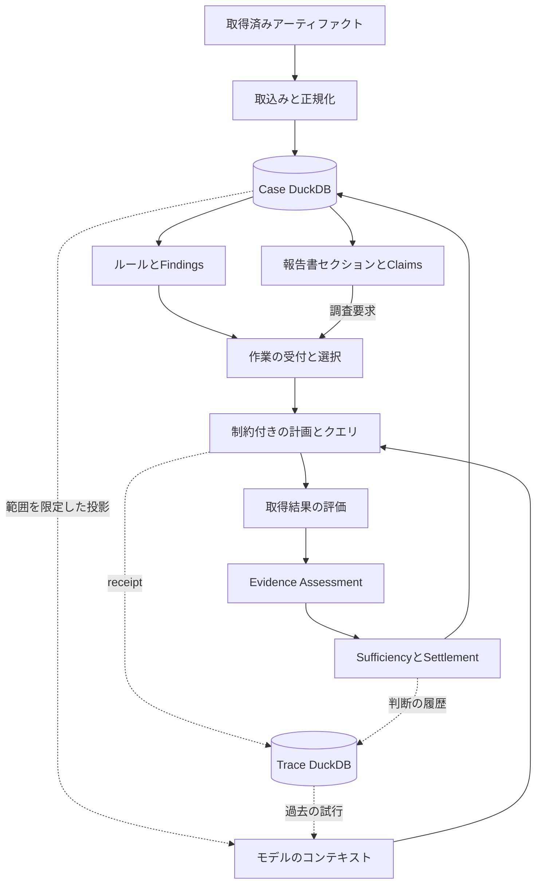

# forensia

[English](README.md) · [日本語](README.ja.md)


**週末のフォレンジック調査を手伝う、ローカルAIアシスタント。**

forensiaは、小型のローカルLLMを使ったデジタルフォレンジック調査のための実験的なハーネスです。取得済みの証拠を整理し、仮説を生成・検証しながら報告書を継続的に更新します。調査者はその結果を確認し、次に何を調べるか判断できます。現在はWindowsのEVTX、MFT、Prefetch、Registryデータに対応しています。

このプロジェクトでは、限られたローカルハードウェア上の小型モデルを、アーキテクチャによって継続的な調査に役立てる方法を探っています。モデルは仮説、検証方法、説明を提案します。ハーネスは検索を実行し、優先順位を計算し、証拠を検査し、状態遷移を記録します。その結果を次の問いの根拠とし、未解決の作業を次のサイクルへ引き継ぎます。

想定するのは、機密性の高いインシデントデータをローカルに留める必要がある、隔離された調査環境です。設計の中心には4B〜8B程度のモデルがあります。各リクエストには狭いタスクと選択したコンテキストを渡し、永続的な調査状態はモデルの外で管理します。

開発の指針は次の3つです。

1. **孤独に戦え** — ローカルモデルと手元にある依存関係で、オフライン実行できること。
2. **LLMに過度な期待をするな** — 提案と解釈を任せ、実行、証拠参照、結論をコードで検証すること。
3. **時間を湯水のように使え** — 明示した予算の範囲内で、証拠の蓄積に応じて仮説を再検討し、報告書を更新すること。停止理由も記録すること。

forensiaはCLIから実行し、Markdown/HTMLの報告書を生成します。調査指示、参考知識、報告書仕様はMarkdownで与えます。対象はシステムから取得済みのアーティファクトであり、証拠の取得やライブレスポンスは対象外です。小型モデルによる調査品質は引き続き実験上の課題であり、ソフトウェアの正しさとは別に評価します。

[クイックスタート](#クイックスタート) · [コマンド](#コマンド) · [Markdown入力](#markdown入力) · [アーキテクチャ](#アーキテクチャ) · [開発](#開発) · [評価](#評価)

## クイックスタート

### インストールと設定

Python **3.14以降**を使ってください。アーティファクトのパーサーにはネイティブ依存があります。CLIがターミナルのみで動くこととは別に、利用するOS向けのwheelが必要です。LLMサーバーは別途起動し、その構成によってGPU要件が決まります。

現在の開発版を使う場合:

```bash
git clone https://github.com/sumeshi/forensia.git
cd forensia
uv sync --dev
cp .env.example .env
```

公開済みのリリースは、`pip install forensia`または`uv tool install forensia`でインストールできます。公開リリースと、ここで説明するソースチェックアウトの内容は異なる場合があります。

OpenAI互換サーバーのエンドポイントと、実際にロードしたモデルを指定します。

```dotenv
LLM_BASE_URL=http://127.0.0.1:8080
LLM_MODEL=your-loaded-model-id
FORENSIA_OUTPUT_LANGUAGE=ja
```

`LLM_BASE_URL`は**`/v1`を含まない**サーバーのルートURLです。クライアントが`/v1/chat/completions`を付加します。認証が必要なら`LLM_API_KEY`を設定してください。コマンドの`--llm-base-url`と`--model`は環境変数より優先されます。ローカル設定として`.env`を読み込むため、公開しないでください。

取得済みのアーティファクトを`./input`に置いて実行します。

```bash
uv run forensia investigate ./case001 ./input --profile windows-basic
```

コマンドをグローバルにインストールした場合は`uv run`を省略できます。エンドポイントとモデルの両方が設定されていなければ、`investigate`は決定論的な証拠処理だけを実行し、LLMによる調査を省略します。設定済みのサーバーが利用できない場合は、上限付きの障害復旧処理に入ります。モデル未設定とは区別されます。

ローカルサーバーを使い、依存関係とモデルファイルを事前に用意していれば、調査と報告書生成はオフラインで完結できます。リモートのエンドポイントには、ケース由来のプロンプト内容が送られます。入力アーティファクト、ケースDB、報告書、Memoryは機密情報として扱ってください。Traceにはモデルへのリクエストと応答も含まれます。取得した証拠のコピーを使い、結論を原本と照合してください。脆弱性の報告先は[SECURITY.md](SECURITY.md)にあります。

### 実行時の予算

設定の実装は[config.py](src/forensia/config.py)にあります。[.env.example](.env.example)は編集用の例であり、プログラムの既定値そのものではありません。予算は実際のモデルとサーバーの能力に合わせてください。

| 設定 | 既定値と意味 |
|---|---|
| `LLM_MAX_TOKENS` | `4096`。応答の最大トークン数 |
| `LLM_CONTEXT_WINDOW_TOKENS` | `0`。設定するまで容量は不明で、プロバイダーに拒否される可能性もある |
| `LLM_TEMPERATURE` | `0.0` |
| `LLM_REASONING_RESERVE_TOKENS` | `0`。推論用に予約する容量 |
| `FORENSIA_OUTPUT_LANGUAGE` | `ja`。`ja`または`en` |
| `FORENSIA_PROMPT_BUDGET_TOKENS` | `0`なら自動の既定値`12000`を使う |
| `FORENSIA_SYSTEM_PROMPT_BUDGET_CHARS` | `0`ならプロンプトのトークン予算の2倍を文字数として使う |
| `FORENSIA_MEMORY_MAX_BYTES` | `0`ならプロンプト予算から4 KiB〜64 KiBのしきい値を導出する |
| `FORENSIA_REPORT_MAX_QUERIES_PER_SECTION` | `3`。報告書のブロックごとのクエリ予算 |
| `FORENSIA_REPORT_MARKDOWN_MAX_ROWS` | `200`。プレビューの行数上限であり、証拠の完全性を示す値ではない |
| `LLM_OUTAGE_WALL_CLOCK_BUDGET_S` | `28800`。障害復旧の最大待機時間 |
| `LLM_OUTAGE_PROBE_INTERVAL_S` | `60`。復旧確認の間隔 |

文字数やトークン数の推定は、コンテキストの選択に使います。プロバイダーが計測した使用量ではありません。実行時のテレメトリーでは、報告された使用量、推定値、取得できない値を区別します。

## コマンド

```bash
# 新規ケースを開始する、または追加の入力を取り込んで調査する。
forensia investigate ./case001 ./input --profile windows-basic

# 既存ケースと、受け付け済みの調査作業から再開する。
forensia investigate ./case001 --max-iter 50

# 追加アーティファクトを取り込み、次の調査実行で正規化・分析する。
forensia add ./case001 ./new-input
forensia investigate ./case001

# LLMを呼ばず、既存の報告書セクションを出力する。
forensia report ./case001

# LLMで報告書セクションを更新してから出力する。
forensia report ./case001 --write

# 実際のオプション仕様を確認する。
forensia investigate --help
forensia report --help
```

`report --output <path>`はHTMLの出力先を指定します。Markdownの報告書は`case001/reports/report.md`に残ります。`investigate --report-only`は調査を省略し、既存の報告書を出力します。報告書の生成は、仮説の確定や調査完了の宣言を行いません。

| 調査オプション | 既定値・動作 |
|---|---|
| `--profile` | `windows-basic`。ルールの選択 |
| `--max-iter` | 調査サイクル数`20` |
| `--max-queries-per-hypothesis` | 選択した仮説ごとのクエリ数`5` |
| `--no-progress-limit` | 意味上の進展がないサイクル数`3` |
| `--report-every-n-cycles` | `3`。報告書セクションの定期更新間隔 |
| `--report-max-queries-per-section` | `0`なら環境変数の設定を使う |
| `--max-llm-calls` | `0`ならセッションの呼出し上限なし。正の値なら各論理呼出しの前に確認し、コンテキスト縮約や失敗した呼出しも数える |
| `--auto-rulepacks / --no-auto-rulepacks` | 有効。観測したアーティファクト種別に適用可能なpackを追加する |
| `--timezone` | `America/New_York`などのIANA名。ケースのmanifestより優先される |
| `--forensia-md`, `--report-spec`, `--knowledge` | 後述するMarkdown入力の明示指定 |
| `--template-dir` | 既存の報告書ディレクトリ入力。`--report-spec`とは排他的 |
| `--rerun` | 現在のケースのテーブルと生成済みの実行時出力を破壊的にリセットし、保持したrawレコードから再正規化する |

通常の再開ではケース状態を保持します。調査中のCtrl-Cは、エンジンが次に中断を扱う境界での停止を要求します。現在の処理が終わるまで待つ場合があります。セッションは終了理由を記録し、後の`investigate`は永続化された作業から再開します。

再開の判定には、Traceのステージreceiptと、有効なsourceの正規化状態を使います。パーサー実装や依存関係が変われば正規化を、ルール・profile・ケースの抑制設定が変われば分析を再実行します。sourceの状態が欠落または失敗している場合、正規化の完了条件を満たしません。

`--rerun`は、対応するスキーマのケース内で調査をやり直す機能です。正規化済みの状態、調査・報告書の状態、入力採用receiptを消去し、有効なsource登録、rawレコード、Memoryを保持します。独立した実験には新しいケースディレクトリを使ってください。現在のスキーマバージョンは**6**です。非対応のスキーマは移行せず拒否します。`--rerun`でも更新できません。

## Markdown入力

入力ごとに役割が異なります。操作者の指示、参考知識、報告書の要件はEvidenceにはならず、ホストによる実行検証やSettlementの検査を迂回できません。

### FORENSIA.md: 調査方針

ケースのルートに`FORENSIA.md`を置くか、ケースの開始・再開時に`--forensia-md <path>`を指定します。エンジンは親ディレクトリや証拠ディレクトリから指示を探しません。

```markdown
# Investigation policy

## Objective
リモートアクセスの後に、無許可の実行が行われたかを確認する。

## Scope
提供されたアーティファクトを使い、欠落したテレメトリーに関する不確実性を残す。

## Priority
調査範囲を広げる前に、リモートログオンとその後のプロセス活動を突き合わせる。

## Constraints
観測された活動と、意図に関する解釈を分ける。
```

本文全体を、Gapの特定、仮説の作成、クエリ計画への指示として使います。英語の`Objective`見出し直下の最初の段落は、既存のobjective admissionへの入力にもなります。`Objective`がなければ`Scope`を使います。他の見出しは指針として扱います。ファイルを編集しても、受け付け済みの作業の撤回、Specの書換え、判定の変更は行いません。

採用時には、本文、SHA-256、入力元、受け取るroleを、Traceの`forensia-md`ステップに保存します。明示指定なしの再開では、ファイルが変わったり消えたりしても記録済みの方針を再利用し、差異を知らせます。編集を明示的に採用する場合:

```bash
forensia investigate ./case001 --forensia-md ./case001/FORENSIA.md
```

採用した方針は、そのセッション中は固定されます。初回採用または明示的な再読込みで、設定したシステムプロンプト文字数予算の半分を超える入力は、理由付きで拒否します。固定のrole・出力スキーマと、Evidence/Assessment/Sufficiency/Settlementの検査は引き続き適用されます。[case_policy.py](src/forensia/ai/investigation/case_policy.py)を参照してください。

### REPORT.md: 報告書仕様

ケースのルートに`REPORT.md`を置くか、`investigate`または`report --write`に`--report-spec <path>`を指定します。既存のsection、Claim、rendererの経路を使います。

```markdown
---
instructions: |
  インシデント対応者向けに書く。証拠参照を示し、観測と解釈を区別し、
  重要な制約を明記する。
---
# 概要

## 評価
証拠が何を裏付けているかと、未確定の解釈を説明する。

# 未解決事項

## 残る調査作業
<!-- mode: table; builder: gaps_unresolved -->

## 追加調査
重要な不確実性を解消するために、次に必要な証拠を示す。
```

各`#`見出しがsectionを、`##`見出しがblockを定義します。任意のfrontmatterの`instructions`は、ファイル内の全sectionに適用されます。メタデータには`type`、`title`、`description`、`tags`、`timestamp`も使えます。実行時の言語は`FORENSIA_OUTPUT_LANGUAGE`で設定します。

少なくとも1つの`#`セクションが必要です。最初のセクションの前に本文を置いたり、正規化後のslugが重複する見出しを使ったりすることはできません。sectionのkeyは見出しの順序と文字列から決まるため、名前や順序の変更は報告書revision内での識別子も変えます。決定論的なblockには、既存のパーサーが`evidence_keypoints`、`mode`、`builder`、`answer_id`、`answer_spec`、`question`のhintを受け付けます。定義は[template_parsing.py](src/forensia/report/sections/template_parsing.py)と[同梱テンプレート](src/forensia/report/templates/)にあります。

初回採用または明示的な再読込みでの優先順位は、明示した`--report-spec`、明示した`--template-dir`、ケースのルートにある`REPORT.md`、ケース内の同梱テンプレートの順です。明示的な報告書入力には、LLMを使う書込み実行が必要です。編集した仕様を採用する場合:

```bash
forensia report ./case001 --write --report-spec ./case001/REPORT.md
```

明示指定なしの再開では、Traceの`report-input`ステップに記録した正規化済みsectionを使い、ファイルの変更を知らせます。通常の`report`は採用済みのsectionを出力します。明示的な再読込み後も古いsectionは保存されますが、有効な報告書からは除外されます。報告書の要件を変えても、調査作業は解決済みになりません。

現在はディレクトリ形式の入力も利用できます。

```bash
forensia templates-export ./my-templates
forensia report ./case001 --write --template-dir ./my-templates
```

番号付きMarkdownファイルでsectionを定義し、`_formats/report.yaml`で決定論的な文言とプレビューの上限を設定します。入力の`case001/REPORT.md`と出力の`case001/reports/report.md`は別ファイルです。出力先の検査で入力への上書きを拒否します。[report_input.py](src/forensia/report/sections/report_input.py)を参照してください。

### Knowledge: ローカルの調査知識

`--knowledge`でディレクトリを渡します。[knowledge.sample/](knowledge.sample/)に例があります。frontmatterに`type: knowledge`を持つMarkdownだけを索引化します。

```markdown
---
type: knowledge
title: リモートアクセスの確認
description: ログオンとその後の活動の相関を調べる。
tags: [windows, logon, rdp]
---
# リモートアクセスの確認

## 相関
レコードを関連付ける前に、host、account、送信元アドレス、時刻を比較する。
```

```bash
forensia investigate ./case001 --knowledge ./knowledge.sample
```

選択は決定論的に行います。tagと検索語で文書を絞り、プロンプト予算内で関連する`##`セクションを選びます。振り分けのための追加LLM呼出しはありません。ファイルごとに1つの話題を扱い、`description`と`tags`を付けてください。`##`セクションがあるファイルでは冒頭の段落を一緒に渡さないため、必須の前提はdescriptionか各sectionに記載してください。

Knowledgeは参考資料であり、証拠やツールの実行許可ではありません。schema card、SQL recipe、phase playbook、Knowledgeの抜粋は、現在の作業と利用可能なcapabilityに応じて開示します。現在のKnowledge索引は実行ごとにリセットされますが、本文はディスクから遅延読込みされます。FORENSIA.mdやREPORT.mdのような、**記録済みrevisionを再開時に再利用する契約はまだありません**。再現性を調べる実験では、実行中にフォルダを変更しないでください。[external.py](src/forensia/knowledge/external.py)と[retrieval.py](src/forensia/knowledge/retrieval.py)を参照してください。

## アーキテクチャ

調査は、アーティファクトの正規化、Findingの検出、仮説の提案と選択、証拠の取得と評価、結果の記録を繰り返します。調査中に報告書を更新し、調査作業として受け付けたGapを次のサイクルへ渡します。

このループを支える責務境界は3つあります。

- **証拠に基づく検証:** 観測、解釈、報告書の主張は役割を分けます。モデルが提案した判定は、証拠のAssessment、Sufficiencyの検査、Settlementのgateを通ってから仮説の状態を変えます。
- **構造化した記憶:** Case Stateは現在の調査状態を、Trace Stateはその進み方を記録し、Working Stateは現在のモデルリクエストに必要なコンテキストを供給します。
- **監査可能性:** 証拠参照と実行receiptで、報告書のClaim、Hypothesis、観測、そのsourceを結び、人が結論の根拠を確認できるようにします。

| 責務 | モデル | ハーネス |
|---|---|---|
| 調査の方向 | 仮説、不足する情報、検証方法を提案する | 作業を受け付け、優先順位を計算し、前提条件と利用可能なcapabilityを確認する |
| 証拠の取得 | 制約内のクエリや、範囲を限定した追加コンテキストを要求する | actionを検証・実行し、結果、制約、provenanceを記録する |
| 解釈 | 観測を説明し、判定を提案する | 宣言された条件を評価し、有効な支持と反証を集約し、状態遷移を検査する |
| 報告 | 説明文を書き、未回答の問いを特定する | 構造化した回答・表を生成し、証拠参照を保持し、公開を検証し、追加調査を受け付ける |

CLIは[pipeline.run_investigation](src/forensia/pipeline.py)を呼び、ケースの作成・再開、取込み、正規化、ルール実行、調査、報告書の出力を行います。`pipeline.run_report`は調査指示を採用せず、報告書入力の採用、任意の書込み、出力を組み立てます。各ケースへの書込みは1つのプロセスが所有します。[調査ループ](src/forensia/ai/investigation/investigator.py)は作業の選択と個々の制約付き試行を調整し、セッション処理は実行状態と予算を記録します。報告書の書込みにも、同じCase/Traceと検証処理を使います。



### Case、Trace、Working State

Case Stateは**何が分かっていて、何が未解決か**を表します。Trace Stateは**何を試み、なぜ現在の状態に至ったか**を表します。Working Stateは**今回のモデルリクエストに何を見せる必要があるか**を表します。同じアプリケーション内の責務境界です。

CaseとTraceはDuckDBに保存します。Working Stateは、そこから選択したレコードの投影、範囲を限定したMarkdownのメモ、関連する参考資料を組み合わせます。仮説の確定やケース完了を決める権限はありません。

| 状態 | 管理するもの |
|---|---|
| `db/case.duckdb` | 正規化済みEvidence、source/Coverage、Findings、HypothesesとVerificationSpec、評価済みの証拠リンク、関係、objective、Gaps/Tasks、報告書sectionとClaims |
| `db/trace.duckdb` | セッションのライフサイクル、ステージ・調査ステップ、仮説の推論、取得処理・LLMのリクエストと応答、入力採用receipt、件数を制限した最近のprogress |
| `memory/` | 範囲を限定した作業用Markdownとcontext card。証拠、判定、完了の正本ではない |
| `reports/` | 生成したMarkdown/HTML、brief、構造化した回答、診断用export |

CaseDBはCaseの接続にTraceをattachし、接続内のviewでTraceのテーブルを公開します。両方のDBを一緒に保存してください。Traceには更新されるライフサイクル行と冪等なステップ書込みがあり、progressの保存件数には上限があります。完全な追記専用event storeでも、全履歴をreplayするエンジンでもありません。DDLとテーブル配置の正本は[schema.py](src/forensia/db/schema.py)、オープン時・バージョンの検査は[database.py](src/forensia/db/database.py)にあります。

Evidenceは、観測を正規化したレコードです。EVTX、MFT、Prefetchの識別子は、source内容の完全なSHA-256と、そのsource内でのレコード識別子を組み合わせます。Registryの識別子はデータセットの構成元を保持します。そのため、異なるsourceに同じローカル番号があっても区別できます。Findingは導出した兆候、Hypothesisは検証する解釈、Claimは報告書の主張、Gapは未解決の情報、Taskは対応する作業を表します。保存されているからといって、同じ証拠上の重みを持つわけではありません。entityのMemory cardは観測された名前と参照を整理するもので、ケース全体のmulti-host identity graphを確立するものではありません。

### 検証とライフサイクル

| 境界 | 判断と実装 |
|---|---|
| VerificationSpec | 受け付けた検証契約を1つに定める。ルール・LLMの宣言は一度だけ正規化し、読出側は保存済みSpecを使う。[verification.py](src/forensia/core/verification.py) |
| Plan/execute | モデルは型付きの`sql.query`または範囲を限定した`memory.read_more`を提案する。ホストはaction、path、読取り専用SQL、テーブル参照、クエリの上限を検証する。[planner.py](src/forensia/ai/investigation/planner.py)、[sql_templates.py](src/forensia/ai/prompts/sql_templates.py) |
| RetrievalEvaluation | 試行の妥当性、観測可能性、部分的な結果、空結果、利用不能を評価する。証拠の支持は判定しない。[retrieval_telemetry.py](src/forensia/ai/retrieval_telemetry.py) |
| Evidence Assessment | 観測を評価可能なSpec条件と照合し、支持・反証・文脈の役割と根拠を記録する。対応できない条件は、流暢な説明があっても満たした扱いにしない。[assessment.py](src/forensia/ai/checking/assessment.py) |
| Evidence Sufficiency | 現在有効な評価済みリンク、Coverage、独立した導出元、反証を集約する。同じ観測への複数クエリは、独立した支持を増やさない。[sufficiency.py](src/forensia/ai/checking/sufficiency.py) |
| Settlement | 上記の結果に照らしてcheckerの判定案を検査する。runnerが受け入れた状態遷移を保存する。[settlement.py](src/forensia/ai/checking/settlement.py) |

モデルはOpenAI互換のchat endpointを通じて、roleごとの構造化した応答を返します。native tool calling、任意のshell、Python実行はaction spaceに含まれません。プロンプト・スキーマ定義は[ai/prompts/](src/forensia/ai/prompts/)と[ai/llm/schemas.py](src/forensia/ai/llm/schemas.py)にあり、正確なフィールド一覧はここに重複掲載しません。

Coverageは、テレメトリーの欠落、部分的な取得、失敗、非対応、利用可能を区別します。パーサーの成功や0行の結果だけでは、完全性を証明できません。空結果による棄却には、明示したrefute条件と、観測可能性を保証した範囲が必要です。現在の保証は保守的で、主にケース全体を対象としたEVTXのevent ID直接検索に限られます。パーサー・pluginの完全性を確認できないRegistry観測は、部分的な取得として扱います。Registry hiveと付随ログはデータセット単位の構成元を保持し、不確かな観測を架空のhostや単一sourceに割り当てません。

証拠リンクにはsource・内容・SpecのfingerprintとAssessmentの根拠を保持します。sourceの置換、内容の変更、Specの変更によって、過去の支持が無効になり、依存する作業が再開される場合があります。古いsourceを退役させるのは、選択した新revisionの正規化が成功するか、明示的に空と確認された後です。最新revisionが失敗している場合、それ以前のrevisionの成功で退役を正当化できません。sourceの遷移はTraceに記録し、保持した置換済みrawファイルは通常の正規化から除外します。[invalidation.py](src/forensia/evidence/invalidation.py)と[content_identity.py](src/forensia/evidence/content_identity.py)を参照してください。

選択、停止分類、再開は、[work_judgment.py](src/forensia/ai/investigation/work_judgment.py)の読出側判断を共有し、[work_state.py](src/forensia/ai/investigation/work_state.py)が永続的な状態遷移を管理します。調査agendaは既存のHypothesis/Gap/Task状態から導出します。未解決なのに実行可能なactionがない作業には、blockerと再試行条件が必要です。成功扱いにはしません。意味上の進展は、作業、観測、反証、source/Coverage状態の変化であり、報告書の文章量が増えることではありません。

セッションは、失敗し得る最終投影を作る前に終了理由を記録し、最後の報告書処理まで所有権を保持します。期限切れのleaseは起動時に整合させます。実行状態と予算がセッションの継続可否を決め、証拠と未解決作業が調査で何を結論できるかを決めます。

Traceは、論理的なLLM呼出し、プロバイダーへのattempt、決定論的な処理を区別します。JSON修復とtransportの再試行は、親request配下のattemptです。復旧後に処理全体を呼び直した場合は、新しいrequestになります。セッションの上限は論理呼出しの入口で適用します。使い切った場合は、モデルを使う最終報告書処理を追加せず、再開可能な停止を記録します。使用量の集計では、プロバイダーが報告したトークン数、ローカルの推定値、不明な使用量を分けます。HTTPクライアントは調査ごとに管理し、終了時に閉じます。[llm_telemetry.py](src/forensia/ai/llm_telemetry.py)を参照してください。

### 作業用コンテキスト

各試行には、現在のSpec、評価済みの支持、反証、未充足の要件、過去の試行を、Case/Traceから決定論的に投影して渡します。Memoryの可視範囲は共有資料と現在の仮説に限定し、`read_more`にも同じ境界を適用します。schema/recipe/playbookの開示は、利用適格性の投影であり、新しい権限システムではありません。

一部のMarkdownはDBから再生成できますが、人が書いたメモやoverviewの文章をすべて復元できるわけではありません。リクエスト時のコンテキスト縮約は、overviewやentityのファイルを変更しません。ファイルサイズの上限によってtaskとsuspicious-evidenceの索引を縮め、古いtimeline項目をarchiveする場合があります。人が書いた文脈を残す場合は、ケースのMemoryも保存してください。短い要約がCase/Traceの正本に置き換わることはありません。Knowledgeは実行時に利用可能なファイルから選択し、[Markdown入力](#knowledge-ローカルの調査知識)で説明したrevision上の制約があります。

### 報告書と監査の履歴

報告書のblockは、利用可能なら決定論的な回答・表を使い、解釈が必要な部分にはLLMの説明文を使います。sectionは証拠参照とClaimを保持し、出力前に品質検査と公開検証を適用します。`draft`、`ai_exhausted`、`human_reviewed`はsectionの作業状態で、仮説の判定や公開可能性とは別です。報告書のGapはadmissionを通じてのみ新しい作業を要求できます。sectionの執筆や完了によって調査仮説を確定することはできません。

レビューでは、報告書のClaimから、引用されたEvidence、Finding、Hypothesisへ参照をたどります。仮説の証拠リンクはAssessmentの根拠を保持し、Traceのステップは計画、取得結果、判断の履歴を記録します。過去のモデル推論は試行の文脈を提供し、結論の検証には観測とそのprovenanceを使います。

典型的なケースの構成:

```text
case001/
├── FORENSIA.md            # 任意の調査方針
├── REPORT.md              # 任意の報告書仕様入力
├── manifest.yaml          # ケースのメタデータとタイムゾーン
├── allowlist.yaml         # ルール単位の抑制設定
├── raw/                   # parse済みJSONL。取得した原本は別途保存する
├── db/
│   ├── case.duckdb         # 現在の証拠とケース状態
│   └── trace.duckdb        # セッション、receipt、推論、テレメトリー
├── memory/                # 人が書いた内容を含む、範囲を限定した作業用Markdown
├── findings/              # Findingの詳細export
├── report_template/       # 配置されたテンプレートと形式設定
└── reports/               # report.md、report.html、構造化した出力・debug出力
```


## ルールと拡張点

既定の[windows-basic profile](src/forensia/knowledge/profiles/windows-basic.yaml)は、Windows、Registry、Prefetch、filesystemのpackを選択します。profileはルールを選び、ルールは検出内容と調査のhintを記述します。観測したアーティファクト種別から適用可能なpackを選ぶこともできます。受け付けるYAMLフィールドは[ルールモデル](src/forensia/knowledge/rules/models.py)が定義し、[rulepacks/](src/forensia/knowledge/rulepacks/)に実行可能な例があります。

ルールの仮説は`confirm_when`、`refute_when`、任意の`evidence_requirements`を宣言し、admissionでVerificationSpecへ変換します。相関、追加調査の問い、制約付きの代替検索は宣言に記載します。event ID、schema card、recipe、artifact capability、Sufficiencyの方針、構造化した質問、判定の語彙は[_schema/](src/forensia/knowledge/rulepacks/_schema/)に置きます。ケースの`allowlist.yaml`による抑制は、Finding生成後にルールIDと証拠行のフィールドを照合します。Findingと証拠は保持します。

既存の最小の拡張点を使ってください。

| 変更 | 実装・宣言の配置先 |
|---|---|
| アーティファクト種別 | [ArtifactAdapter registry](src/forensia/evidence/artifacts.py)、parser/normalizer、現在のDBスキーマ、Coverage、source置換の経路 |
| 検出やルールの選択 | Rulepack YAMLと[profiles](src/forensia/knowledge/profiles/) |
| 構造化した質問 | [question_routing.yaml](src/forensia/knowledge/rulepacks/_schema/question_routing.yaml)。汎用SQLで足りない場合だけ専用の[answer builder](src/forensia/report/answers/answer_registry.py)を追加する |
| 報告書の構成 | REPORT.mdと既存のsection parser。登録済みの[keypoints](src/forensia/report/answers/keypoint_catalog.py)を再利用する |
| 決定論的な報告書の表 | [table_registry.py](src/forensia/report/answers/table_registry.py)と[report_tables.yaml](src/forensia/knowledge/rulepacks/_schema/report_tables.yaml) |
| 報告書の品質検査 | [quality_gates.py](src/forensia/report/sections/quality_gates.py)。理由とconfidenceの上限を持つ、副作用のない検査 |

[tests/test_extension_points.py](tests/test_extension_points.py)に実行可能な例があります。これらはプロセス内の登録用の接続点で、plugin loaderではありません。ケース固有の回答や識別子を汎用Pythonに埋め込まず、どの拡張でも証拠参照を維持してください。

## 開発

### 実装の配置

| 場所 | 責務 |
|---|---|
| [pipeline.py](src/forensia/pipeline.py)、[cli/](src/forensia/cli/) | ステージの組立てと、コマンド・表示への適応 |
| [core/](src/forensia/core/)、[db/](src/forensia/db/) | Case/session/verificationの基本要素、保存契約、状態へのアクセス |
| [evidence/](src/forensia/evidence/) | アーティファクトの受付、parse、正規化、識別、無効化 |
| [knowledge/](src/forensia/knowledge/) | 宣言的なルール・catalog、Coverage、Knowledgeの選択 |
| [ai/investigation/](src/forensia/ai/investigation/)、[ai/hypotheses/](src/forensia/ai/hypotheses/) | 作業の選択、ライフサイクル、計画、仮説の実行 |
| [ai/checking/](src/forensia/ai/checking/)、[ai/llm/](src/forensia/ai/llm/) | 検証gateと、制約付きのモデル通信 |
| [ai/sections/](src/forensia/ai/sections/)、[report/](src/forensia/report/) | 報告書blockの実行、決定論的な回答、Claims、公開検査、出力 |

状態を追加する前に、既存の書込み責務を確認してください。別のagenda、planner、cache、status modelを追加するより、その責務を拡張します。同じ不変条件を守り、同程度の品質が得られるなら、独立した状態、同期経路、モデル呼出しが少ない構成を優先します。[scripts/check_imports.py](scripts/check_imports.py)は依存方向を検査します。互換性のない永続化の変更では、全consumerと現在のスキーマバージョンを一緒に更新します。自動migration/backfillやaliasの維持は行いません。古いケースデータは保全し、必要なら新しいディレクトリへ原本を再取込みしてください。

### 検証

開発用チェックアウトで実行します。

```bash
uv run pytest tests/ -q
uv run ruff check src tests scripts
uv run ruff format --check src tests scripts
uv run python scripts/check_imports.py
uv run python scripts/audit_schema_coverage.py --strict
uv run python scripts/regenerate_playbook.py --check
uv run forensia doctor
```

`doctor`と`templates-export`は、トップレベルのhelpには表示しない保守用コマンドです。doctorはインストール済みの宣言、同梱した報告書テンプレート、使い捨てのCase/Traceへの永続化を検査します。ソースチェックアウト、テスト、開発ツールは不要です。CIは上記の開発検査を明示的に実行し、doctorで代替しません。

pytestはオフラインで、使い捨てのケースに対して実行してください。モデル・プロバイダーとの境界をmockし、実際の保存処理、CLIの動作、生成物を確認します。Evidence/provenance、Assessment/Sufficiency/Settlement、実行上限、作業の受付、停止、再開のテストを保持します。各不変条件には主となるテストを1つ定めます。廃止したAPIのテストは削除し、実装の形を固定するだけの定数、SQL文字列、内部counter、文章のassertionを避けてください。実モデルによる品質・性能実験はpytestの外で行います。

宣言を変更した場合は[audit_schema_coverage.py](scripts/audit_schema_coverage.py)を実行します。[regenerate_playbook.py](scripts/regenerate_playbook.py)はYAMLからplaybookの指定部分を再生成し、`--check`でずれを検出します。[cycle_summary.py](scripts/cycle_summary.py)はTraceの最近のprogressを読むため、件数上限で削除した古いサイクルは表示されない場合があります。

現在の使い方、アーキテクチャ、拡張、開発方針の正本は[README.md](README.md)で、この文書はその日本語訳です。テーブル一覧やファイルごとの説明を別途重複管理せず、実行可能なスキーマと責務を持つソースへリンクします。設計案や未完了タスクは現在の機能説明と分け、実装の履歴はgitに残します。動作を変えた場合は、両言語版の該当箇所を更新してください。PRには具体的な変更、理由、確認内容を記載し、機密情報を除いた再現手順はissueに置きます。意図的な破壊的変更を許容し、古いテストやドキュメントのために廃止した経路を残しません。

## 評価

この実験で問うのは、単純なハーネスが、弱いローカルモデルを呼出し・トークン・時間の予算内で根拠のある結論へ導けるかです。決定論的なテストはソフトウェアの契約を確認します。調査品質と性能には、別途計測が必要です。

公開されている[CFReDS Data Leakage Case](https://cfreds-archive.nist.gov/data_leakage_case/data-leakage-case.html)を評価用データの1つとして使います。[BENCHMARK.md](BENCHMARK.md)には、選定した問いと参照回答を、製品への指示とは分けた評価資料として置いています。リポジトリにはイメージ、抽出済みの証拠、生成済みケースを配布しません。期待する回答は、モデルのKnowledgeや報告書入力に含めないでください。

比較では、source内容、コード・モデルのrevision、endpoint設定、プロンプト・Knowledge・報告書仕様、予算を固定します。裏付けられた結論と見落とした問い、false positive/false negative、未解決作業、無効・反復した試行、仮説の多様性、コンテキストの重複、呼出し・トークン・時間のコスト、再開動作を記録します。より単純な構成と比較し、正しさの修正とモデル品質の変化を分けてください。モデルのばらつきが差を説明し得る場合は、複数回実行します。

既存のオフライン診断スクリプトは、完了済みケースの**コピー**に対して実行できます。

```bash
uv run python scripts/eval_run.py ./case-copy --output ./evaluation.json
```

指標はヒューリスティックで、完全な採点器ではありません。一部はMarkdown Memoryや古い報告書JSON exportを読みます。`confirmed_while_benign_rate`は現在、注記付きで0を返すplaceholderであり、計測したfalse positive率ではありません。入力やannotationが欠けた指標では品質を証明できません。評価を現在のCase/Trace出力へ対応させ、条件を統制したローカルモデルの比較を行う作業は未完了です。

## ライセンス

[MIT](LICENSE)。
