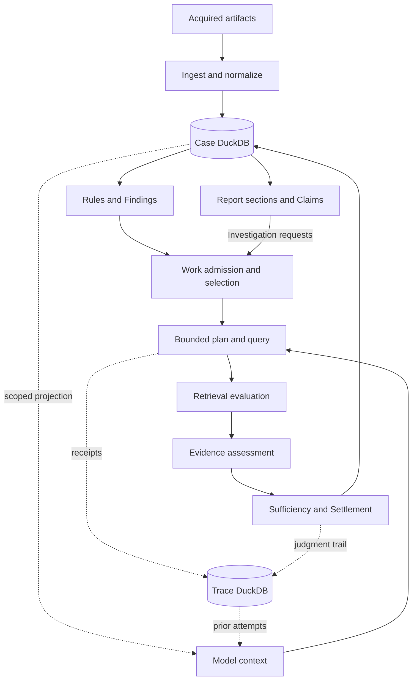

# forensia

[English](README.md) · [日本語](README.ja.md)


**Your local AI assistant for weekend forensic work.**

forensia is an experimental harness for digital forensic investigations with small local LLMs. It organizes acquired evidence, generates and tests hypotheses, and continuously updates a report so investigators can review the findings and decide what to investigate next. The current artifact support covers Windows EVTX, MFT, Prefetch, and Registry data.

The project explores how architecture can make a small model useful for sustained investigation on modest local hardware. The model proposes hypotheses, verification approaches, and explanations. The harness executes searches, calculates priorities, checks evidence, and records state transitions. Results become the basis for the next question, with unresolved work carried into subsequent cycles.

The intended setting is an isolated investigation environment where sensitive incident data must stay local. Models around 4B–8B parameters motivate the design: each request receives a narrow task and a selected context, while durable investigation state is maintained outside the model.

Three principles guide the work:

1. **Fight alone** — run offline with a local model and locally available dependencies.
2. **Do not over-expect from the LLM** — ask it to propose and interpret; validate execution, evidence references, and conclusions in code.
3. **Spend time like water** — revisit hypotheses and update reports as evidence accumulates, within explicit budgets and with a recorded reason for stopping.

forensia runs through a CLI and produces Markdown/HTML reports. Markdown files provide investigation instructions, reference knowledge, and report specifications. It operates on artifacts already acquired from a system; evidence acquisition and live response are outside its scope. Investigation quality with small models remains an experimental question, evaluated separately from software correctness.

[Quick start](#quick-start) · [Commands](#commands) · [Markdown inputs](#markdown-inputs) · [Architecture](#architecture) · [Development](#development) · [Evaluation](#evaluation)

## Quick start

### Install and configure

Use Python **3.14 or later**. Artifact parsers include native dependencies; wheel availability on your OS is a separate requirement from the CLI being terminal-only. The LLM server runs separately and determines GPU requirements.

For current development:

```bash
git clone https://github.com/sumeshi/forensia.git
cd forensia
uv sync --dev
cp .env.example .env
```

For a published release, use `pip install forensia` or `uv tool install forensia`. A published release may differ from the source checkout described here.

Set the endpoint and the model actually loaded by your OpenAI-compatible server:

```dotenv
LLM_BASE_URL=http://127.0.0.1:8080
LLM_MODEL=your-loaded-model-id
FORENSIA_OUTPUT_LANGUAGE=ja
```

`LLM_BASE_URL` is the server root, **without `/v1`**: the client appends `/v1/chat/completions`. Set `LLM_API_KEY` when authentication is needed. Command options `--llm-base-url` and `--model` override the environment. `.env` is loaded for local configuration; keep it private.

Run with acquired artifacts in `./input`:

```bash
uv run forensia investigate ./case001 ./input
```

After installing the command globally, omit `uv run`. Without both an endpoint and model, `investigate` runs the deterministic evidence stages and skips the LLM investigation. A configured but unavailable server enters bounded outage recovery; it is not treated as an unconfigured model.

With a local server and dependencies/model files already installed, investigation and report generation can run offline. A remote endpoint receives case-derived prompt content. Treat input artifacts, case databases, reports, and memory as sensitive; Trace includes model requests and responses. Use copies of acquired evidence and review conclusions against their sources. See [SECURITY.md](SECURITY.md) for vulnerability reporting.

### Runtime budgets

The configuration owner is [config.py](src/forensia/config.py); [.env.example](.env.example) is an editable example, not the program defaults. Size budgets to the actual model/server capacity.

| Setting | Default and meaning |
|---|---|
| `LLM_MAX_TOKENS` | `4096`; maximum completion tokens |
| `LLM_CONTEXT_WINDOW_TOKENS` | `0`; unknown capacity until configured, with provider rejection still possible |
| `LLM_TEMPERATURE` | `0.0` |
| `LLM_REASONING_RESERVE_TOKENS` | `0`; reserved capacity for reasoning |
| `FORENSIA_OUTPUT_LANGUAGE` | `ja`; `ja` or `en` |
| `FORENSIA_PROMPT_BUDGET_TOKENS` | `0` selects the automatic default of `12000` |
| `FORENSIA_SYSTEM_PROMPT_BUDGET_CHARS` | `0` derives twice the prompt token budget in characters |
| `FORENSIA_MEMORY_MAX_BYTES` | `0` derives a threshold between 4 KiB and 64 KiB from the prompt budget |
| `FORENSIA_REPORT_MAX_QUERIES_PER_SECTION` | `3`; query budget per report block |
| `FORENSIA_REPORT_MARKDOWN_MAX_ROWS` | `200`; preview row limit, not an evidence-completeness measure |
| `LLM_OUTAGE_WALL_CLOCK_BUDGET_S` | `28800`; maximum outage recovery wait |
| `LLM_OUTAGE_PROBE_INTERVAL_S` | `60`; recovery probe interval |

Character and token estimates guide context selection; they are not measured provider usage. Runtime telemetry distinguishes reported usage, estimates, and unavailable values.

## Commands

```bash
# Start a new case, or ingest and investigate additional input.
forensia investigate ./case001 ./input

# Resume using the existing case and its admitted work.
forensia investigate ./case001 --max-iter 50

# Stage additional artifacts; then normalize/analyze them on investigation.
forensia add ./case001 ./new-input
forensia investigate ./case001

# Render existing report sections without LLM calls.
forensia report ./case001

# Refill report sections using the LLM, then render.
forensia report ./case001 --write

# Inspect the actual option contract.
forensia investigate --help
forensia report --help
```

`report --output <path>` chooses an HTML output path; the Markdown report stays under `case001/reports/report.md`. `investigate --report-only` skips investigation and renders the existing report. A report job does not settle hypotheses or declare the investigation complete.

| Investigation option | Default / behavior |
|---|---|
| `--max-iter` | `20` investigation cycles |
| `--max-queries-per-hypothesis` | `5` queries per selected hypothesis |
| `--no-progress-limit` | `3` cycles without semantic progress |
| `--report-every-n-cycles` | `3`; periodic section refresh |
| `--report-max-queries-per-section` | `0` uses the environment setting |
| `--max-llm-calls` | `0` disables the session cap; a positive cap is checked before each logical call, including compaction and failed calls |
| `--timezone` | An IANA name, such as `America/New_York`; overrides the case manifest |
| `--forensia-md`, `--report-spec`, `--knowledge` | Explicit Markdown inputs described below |
| `--template-dir` | Existing report-directory input; mutually exclusive with `--report-spec` |
| `--rerun` | Destructive reset of current case tables and generated runtime outputs, then re-normalization from retained raw records |

Ordinary resume preserves case state. Ctrl-C during the investigation requests a stop at the engine's next handling boundary; it may wait for the current operation. The session records its terminal reason, and later `investigate` resumes from durable work.

Resume uses Trace stage receipts and the active sources' normalization status. Changes to parser implementation/dependencies rerun normalization; rule definitions or case suppression changes rerun analysis. A missing or failed source status cannot satisfy the normalization gate.

`--rerun` is a fresh investigation within a compatible case: it clears normalized and investigation/report state and input-adoption receipts, while retaining active source registrations, raw records, and memory. The current schema version is **7**; unsupported schema versions are rejected, not migrated, and `--rerun` cannot upgrade them. The parser raw-record contract also changed in this version, so create a new case and reingest the acquired originals when moving from an earlier case.

## Markdown inputs

These inputs have different roles. Operator instructions, reference knowledge, and report requirements never become Evidence or bypass the host's execution and settlement checks.

### FORENSIA.md: investigation policy

Place `FORENSIA.md` in the case root, or pass `--forensia-md <path>` when starting or resuming a case. The engine does not search parent directories or the evidence directory for instructions.

The default investigation does not assume an incident type. Describe the purpose and scope of a case in `FORENSIA.md`.

```markdown
# Investigation policy

## Objective
Determine whether remote access was followed by unauthorized execution.

## Scope
Use the supplied artifacts and retain uncertainty about missing telemetry.

## Priority
Correlate remote logons with subsequent process activity before expanding scope.

## Constraints
Separate observed activity from interpretations about intent.
```

The entire body guides gap identification, hypothesis drafting, and query planning. The first paragraph under an English `Objective` heading (or `Scope` when Objective is absent) also supplies the existing objective-admission input. Other headings remain guidance. Editing the file does not withdraw admitted work, rewrite a Spec, or change a verdict.

At adoption, the body, SHA-256, source, and receiving roles are saved in a `forensia-md` Trace step. An implicit resume reuses the recorded policy, even when the file changes or disappears, and surfaces the difference. Explicitly adopt an edit with:

```bash
forensia investigate ./case001 --forensia-md ./case001/FORENSIA.md
```

The adopted policy is fixed for that session. A first adoption or explicit reload exceeding half the configured system-prompt character budget is rejected with a reason. The fixed role/output schema and Evidence/Assessment/Sufficiency/Settlement gates continue to apply. See [case_policy.py](src/forensia/investigation/case_policy.py).

### REPORT.md: report specification

Place `REPORT.md` in the case root, or pass `--report-spec <path>` to `investigate` or `report --write`. This uses the existing section, Claim, and renderer pipeline.

```markdown
---
instructions: |
  Write for incident responders. Cite evidence references, distinguish
  observations from interpretation, and state material limitations.
---
# Overview

## Assessment
Explain what the evidence supports and which interpretations remain open.

# Gaps

## Unresolved work
<!-- mode: table; builder: gaps_unresolved -->

## Follow-up
Describe the next evidence needed to resolve each material uncertainty.
```

Each `#` heading defines a section; `##` headings define blocks. Optional frontmatter `instructions` applies to every section in the file. Supported metadata also includes `type`, `title`, `description`, `tags`, and `timestamp`. Use `FORENSIA_OUTPUT_LANGUAGE` for the runtime language setting.

A file must have at least one `#` section, no prose before the first section, and no headings that normalize to the same slug. Section keys are based on heading order and text, so renaming/reordering headings changes their identity within the report revision. For deterministic blocks, the existing parser accepts `evidence_keypoints`, `mode`, `builder`, `answer_id`, `answer_spec`, and `question` hints; definitions live in [template_parsing.py](src/forensia/report/sections/template_parsing.py) and the [bundled templates](src/forensia/data/report/).

Input priority on first adoption or explicit reload is: explicit `--report-spec`, explicit `--template-dir`, case-root `REPORT.md`, then case-local packaged templates. Explicit report inputs require an LLM-backed writing run. To adopt an edited specification:

```bash
forensia report ./case001 --write --report-spec ./case001/REPORT.md
```

Implicit resume uses the normalized sections recorded in the `report-input` Trace step and reports file changes. Plain `report` renders the adopted sections. Older sections remain stored but are excluded from the active report after an explicit reload. Changing report requirements does not resolve investigation work.

The current directory-based input also remains available:

```bash
forensia templates-export ./my-templates
forensia report ./case001 --write --template-dir ./my-templates
```

Its numbered Markdown files define sections; `_formats/report.yaml` controls deterministic wording and preview limits. Input `case001/REPORT.md` and generated `case001/reports/report.md` are separate files; output guards reject overwriting the input. See [report_input.py](src/forensia/report/sections/report_input.py).

### Knowledge: local investigation guidance

Pass a directory with `--knowledge`; [knowledge.sample/](knowledge.sample/) contains examples. Only Markdown with `type: knowledge` frontmatter is indexed.

```markdown
---
type: knowledge
title: Remote access review
description: Correlating logons with subsequent activity.
tags: [windows, logon, rdp]
---
# Remote access review

## Correlation
Compare host, account, source address, and time before connecting records.
```

```bash
forensia investigate ./case001 --knowledge ./knowledge.sample
```

Selection is deterministic: tags and query terms narrow documents, then relevant `##` sections are chosen within the prompt budget. There is no extra LLM routing call. Keep one topic per file and include `description` and `tags`. When a file has `##` sections, put essential context in its description or sections; its opening paragraph is not injected alongside them.

Knowledge is reference material, not evidence or tool permission. Schema cards, SQL recipes, phase playbooks, and these snippets are disclosed according to current work and capabilities. The current Knowledge index is reset per invocation, but bodies are read lazily from disk; Knowledge does **not yet have the recorded-revision resume contract** of FORENSIA.md and REPORT.md. Keep the folder unchanged during a reproducibility experiment. See [external.py](src/forensia/knowledge/external.py) and [retrieval.py](src/forensia/knowledge/retrieval.py).

## Architecture

The investigation follows a repeated sequence: normalize artifacts, detect findings, propose and select hypotheses, retrieve evidence, assess it, and record the result. Reports are refreshed during the investigation, and admitted gaps feed subsequent cycles.

Three boundaries support this loop:

- **Evidence-bound verification:** observations, interpretations, and report claims have distinct roles. A model's proposed verdict passes through evidence assessment, sufficiency checks, and a settlement gate before it changes a hypothesis's state.
- **Structured memory:** Case State holds the current investigation, Trace State records how it progressed, and Working State supplies the context for the current model request.
- **Auditability:** evidence references and execution receipts connect report claims, hypotheses, observations, and their sources so a person can inspect the grounds for a conclusion.

| Responsibility | Model | Harness |
|---|---|---|
| Investigation direction | Propose hypotheses, missing information, and verification approaches | Admit work, calculate priority, check prerequisites and available capabilities |
| Evidence retrieval | Propose a bounded query or request additional scoped context | Validate and execute the action; record results, limits, and provenance |
| Interpretation | Explain observations and propose a verdict | Assess declared conditions, aggregate eligible support and contradictions, gate the state transition |
| Reporting | Write explanatory passages and identify unanswered questions | Generate structured answers/tables, retain evidence references, validate publication, admit follow-up work |

The CLI calls [pipeline.run_investigation](src/forensia/pipeline.py) for case creation/resume, ingest, normalization, rules, investigation, and report rendering. `pipeline.run_report` assembles report input adoption, optional writing, and rendering without adopting investigation instructions. One process owns writes to each case. The [investigation loop](src/forensia/investigation/investigator.py) coordinates work selection and individual bounded attempts; session handling records execution status and budgets. Report writing reads the same Case/Trace state and applies report-specific evidence and publication checks. Follow-up admission remains with the investigation loop.



### Case, Trace, and Working State

Case State answers **what is known and unresolved**. Trace State answers **what was attempted and why the current state was reached**. Working State answers **what this model request needs to see**. These are responsibility boundaries within the same application.

Case and Trace are stored in DuckDB. Working State combines a selected projection of their records with scoped Markdown notes and relevant reference material; it has no authority to settle a hypothesis or declare the case complete.

| State | What it owns |
|---|---|
| `db/case.duckdb` | Normalized evidence, sources/Coverage, Findings, Hypotheses and VerificationSpec, assessed evidence links, relations, objective, Gaps/Tasks, report sections and Claims |
| `db/trace.duckdb` | Session lifecycle, stage/investigation steps, hypothesis reasoning, retrieval/LLM request and response records, input-adoption receipts, and bounded recent progress |
| `memory/` | Scoped working Markdown and context cards; not the authority for evidence, verdicts, or completion |
| `reports/` | Generated Markdown/HTML, briefs, structured answers, and diagnostic exports |

CaseDB attaches Trace to the Case connection and exposes its tables through connection-local views. Preserve both databases together. Trace includes updated lifecycle rows and idempotent step writes, and progress is bounded; it is not a fully append-only event store or a complete historical replay engine. The authoritative DDL and table placement are in [schema.py](src/forensia/db/schema.py), with opening/version checks in [database.py](src/forensia/db/database.py).

Evidence is an observed normalized record. EVTX, MFT, and Prefetch identifiers combine the full source-content SHA-256 with the record's identity within that source; Registry identifiers retain dataset contributors. Records with the same local number in different sources therefore remain distinct. A Finding is a derived signal; a Hypothesis is an interpretation to test; a Claim is an assertion in the report; a Gap describes unresolved information and a Task the associated work. Persisting these objects does not give them equal evidentiary weight. Entity memory cards organize observed names and references; they do not establish a case-wide multi-host identity graph.

EVTX, MFT, Registry, and Prefetch ingestion uses evtx2es 1.12, mft2es 1.10, reg2es 2.3, and prefetch2es 2.6. The parser's native JSONL is retained as raw input. Normalization assigns source IDs from the full input SHA-256 and uses that identity for EVTX, MFT, and Prefetch Evidence IDs; Registry artifact IDs retain their dataset contributors. MFT `size` denotes the FileName attribute logical-size snapshot; full DATA attributes remain in `raw_json`. MFT and Prefetch timelines are derived during DuckDB normalization from parser entry records, without parsing the source a second time. Registry JSONL is streamed and validated strictly before its records are admitted.

A valid empty EVTX is recorded as empty; a zero-record Prefetch export is rejected before publication. Registry uses `error_policy="raise"`, but plugins can still warn and skip unsupported records internally. Parser success and row counts do not prove completeness; Registry capability coverage remains partial where plugin completeness is unproven.

### Verification and lifecycle

| Boundary | Decision and owner |
|---|---|
| VerificationSpec | One admitted verification contract. Rule/LLM declarations are normalized once; readers use the stored Spec. [verification.py](src/forensia/core/verification.py) |
| Plan/execute | The model proposes typed `sql.query` or scoped `memory.read_more` actions. The host validates action, paths, read-only SQL, table references, and query bounds. [planner.py](src/forensia/investigation/planner.py), [sql_templates.py](src/forensia/context/sql_templates.py) |
| RetrievalEvaluation | Whether that attempt was valid, observable, partial, empty, or unavailable; it does not assign evidentiary support. [retrieval.py](src/forensia/context/retrieval.py) |
| Evidence Assessment | Match observations to evaluable Spec conditions and record supporting/contradictory/contextual roles with grounds. Unsupported conditions are not satisfied by a fluent explanation. [assessment.py](src/forensia/investigation/verification/assessment.py) |
| Evidence Sufficiency | Aggregate current assessed links, Coverage, independent derivation roots, and contradictions. Multiple queries over the same observation do not create independent support. [sufficiency.py](src/forensia/investigation/verification/sufficiency.py) |
| Settlement | Gate the checker's proposed verdict against those results; the runner persists the accepted transition. [settlement.py](src/forensia/investigation/verification/settlement.py) |

The model uses role-specific structured responses through an OpenAI-compatible chat endpoint. Native tool calling, arbitrary shell, and Python execution are not part of the action space. Domain prompt builders live in [investigation/prompts.py](src/forensia/investigation/prompts.py) and [report/sections/prompts.py](src/forensia/report/sections/prompts.py). They share [context/](src/forensia/context/) projections and [llm/schemas.py](src/forensia/llm/schemas.py) response contracts; their exact fields are not duplicated here.

Coverage separates absent, partial, failed, unsupported, and available telemetry. Parser success or zero rows alone does not prove completeness. Empty-result refutation needs an explicit refute condition and a certified observable scope; the present certification is conservative and centered on direct case-wide EVTX event-ID lookups. Registry observations remain partial when parser/plugin completeness is unproven. Registry hives and companion logs retain dataset-level contributors rather than assigning uncertain observations to an invented host or single source.

Evidence links retain source/content/Spec fingerprints and assessment grounds. Source replacement, content changes, or a changed Spec can make historical support ineligible and reopen dependent work. A replacement retires the old source only after the selected new revision normalizes successfully or is explicitly empty; a failed latest revision cannot authorize retirement through an earlier revision. Trace records the source transition, and retained superseded raw files are excluded from ordinary normalization. See [invalidation.py](src/forensia/evidence/invalidation.py) and [content_identity.py](src/forensia/evidence/content_identity.py).

Selection, stop classification, and reopening share the read-side judgment in [work_judgment.py](src/forensia/investigation/work_judgment.py); [work_state.py](src/forensia/investigation/work_state.py) owns the durable transitions. The investigation agenda is derived from existing Hypothesis/Gap/Task state. Unresolved work with no runnable action needs a blocker and retry condition, not a successful completion label. Semantic progress is a change in work, observations, contradictions, or source/Coverage state, not growth in report prose.

Session lifecycle records a terminal reason before fallible final projections and retains ownership through the closing report pass. Expired leases are reconciled at startup. Execution status and budgets govern whether the session continues; evidence and unresolved work govern what the investigation can conclude.

Trace distinguishes logical LLM calls, provider attempts, and deterministic operations. JSON repair and transport retries are attempts under their parent request; a recovered operation that is invoked again starts new requests. The session cap applies at the logical-call entry, and exhaustion records a resumable stop without another model-dependent final report pass. Usage aggregates keep provider-reported tokens, local estimates, and unknown usage separate. HTTP clients are scoped to the investigation and closed at its end. See [telemetry.py](src/forensia/llm/telemetry.py).

### Working context

Each attempt gets a deterministic work projection from Case/Trace: current Spec, assessed support, contradictions, unmet requirements, and prior attempts. Memory visibility is scoped to shared material and the current hypothesis; `read_more` enforces the same boundary. Schema/recipe/playbook disclosure is a projection of eligibility, not a new permission system.

Some Markdown can be regenerated from the DB; authored notes and overview prose cannot all be reconstructed. Request-time context reductions leave overview and entity files intact. File size limits trim task and suspicious-evidence indexes, while older timeline entries can be archived. Preserve the case's memory when retaining authored context. A compact summary never replaces authoritative Case/Trace state. Knowledge selection uses the files available to the invocation, with the revision limitations described in [Markdown inputs](#knowledge-local-investigation-guidance).

### Reports and audit trail

Report blocks use deterministic answers/tables where available and LLM narration where interpretation is needed. Sections retain evidence references and Claims, with quality checks and publication validation applied before rendering. `draft`, `ai_exhausted`, and `human_reviewed` are section workflow states, distinct from hypothesis verdicts and publication readiness. Report gaps can request new work only through admission; writing or completing a section cannot settle an investigation hypothesis.

Review follows references from a report Claim to its cited Evidence, Finding, or Hypothesis. Hypothesis evidence links retain assessment grounds; Trace steps record the plans, retrieval outcomes, and judgment history. Prior model reasoning provides context for an attempt, while the observations and their provenance provide the basis for checking its conclusion.

Typical case layout:

```text
case001/
├── FORENSIA.md            # optional operator investigation policy
├── REPORT.md              # optional report specification input
├── manifest.yaml          # case metadata and timezone
├── allowlist.yaml         # rule-scoped suppression
├── raw/                   # parsed JSONL; retain original acquired artifacts separately
├── db/
│   ├── case.duckdb         # current evidence and case state
│   └── trace.duckdb        # sessions, receipts, reasoning, telemetry
├── memory/                # scoped working Markdown, including authored material
├── findings/              # finding detail exports
├── report_template/       # seeded templates and format settings
└── reports/               # report.md, report.html, structured/debug outputs
```


## Rules and extension points

The common evidence rules are available to every case; there is no incident profile, automatic pack selection, or separate artifact-eligibility stage. SQL rules query their artifact-specific normalized tables. A Sigma target is bound to declared EVTX channels, providers, and, when specified, event IDs. Its per-case receipt distinguishes a completed query from `not_observed`, when the case has no matching telemetry and the query was skipped. A completed query with zero matches and a target that was not observed are different results; neither proves that an intrusion did not occur. The [rule model](src/forensia/knowledge/rules/models.py) owns the shared execution contract. Directories under [data/rules/](src/forensia/data/rules/) organize rules; they do not control selection.

The full SigmaHQ `rules/windows/` source is a Git submodule at [knowledge/sigmahq](knowledge/sigmahq/). Its commit is fixed by the parent repository's gitlink, currently `8a4813404ea3074890e0cda9272d4d1a8b2941d6`. The developer-only dependencies include pySigma and its Windows and Sysmon pipelines. The builder converts each source rule for its declared target pipeline; category rules can produce independent Security, Sysmon, or service bindings. Each binding has a target-specific Rule ID, so one source rule can have more than one result. Field and event mappings are declared in [schema.yaml](scripts/sigma/schema.yaml). The generated [Sigma bundle](src/forensia/data/sigma/sigma_bundle.json) contains precompiled Rules for the existing DuckDB rule and Finding path. Runtime reads this bundle offline; it does not need the submodule, regression fixtures, pySigma, or network access.

The bundle keeps three outcomes separate for each target binding: conversion (`converted`, `unsupported`, or `failed`), SQL validation (`passed` or `failed`), and fixture validation (`passed`, `mismatch`, `error`, `not_applicable`, or `absent`). One shared admission rule accepts a binding only when conversion succeeded, SQL validation passed, and its fixture result is `passed`, `not_applicable`, or `absent`. `not_applicable` means the source's declared fixtures do not match that target's telemetry; `absent` means the source declares no fixture. The top-level semantic contract records common boundary checks once. Every converted query gets a DuckDB `EXPLAIN` and execution check against the schema. A small shared semantic contract uses typed synthetic rows to check common converter behavior once. These establish query viability and shared semantics, not per-rule detection correctness. A `passed` fixture means its declared expectations and Evidence references matched through the validation path. It describes only that fixture and does not measure false-positive rate, detection coverage, or whether an incident occurred. Bundle target support and fixture outcomes do not claim that a case contains that telemetry. Per-case receipts report `completed` and match counts when the target is observed, and `not_observed` when it is absent. Missing telemetry or zero matches is not evidence that no incident occurred.

The bundle summary separates original source rules from target bindings with `total`, `bindings`, `admitted_rules`, and `admitted_bindings`; `by_conversion`, `by_fixture`, and `by_target` show their outcomes and target counts. Targets that did not convert have no SQL or fixture validation and count as `not_run` in `by_fixture`. It records the actual submodule commit and source hashes for integrity and reproducibility; the parent gitlink is the sole source revision pin. The common rule set also includes 22 artifact SQL rules for filesystem observations, Prefetch execution history, and Registry configuration/history. These record observations without asserting transfer, malware, or hostile intent from a filename or application alone. The bundle preserves source paths and rule authors, and the runtime includes the [Detection Rule License 1.1](src/forensia/data/sigma/SIGMA_LICENSE.txt). The SigmaHQ license notice remains with the submodule source.

SQL rules can optionally declare hypotheses with `confirm_when`, `refute_when`, and optional `evidence_requirements`; admission converts them to VerificationSpec. Correlation, follow-up questions, and bounded fallback searches belong in declarations. Event IDs, schema cards, recipes, artifact capabilities, sufficiency policy, structured questions, and verdict vocabulary live in [data/schema/](src/forensia/data/schema/). Suppression in case `allowlist.yaml` matches a rule ID and evidence-row fields after finding generation; it retains the finding and its evidence.

Prefer the smallest existing extension point:

| Change | Owner |
|---|---|
| Artifact family | [ArtifactAdapter registry](src/forensia/evidence/artifacts.py), parser/normalizer, current DB schema, Coverage, and source replacement path |
| Detection | SQL rule YAML under [data/rules/](src/forensia/data/rules/); Sigma submodule source under [knowledge/sigmahq/rules/windows/](knowledge/sigmahq/rules/windows/), compiled by [converter.py](scripts/sigma/converter.py) and [build.py](scripts/sigma/build.py), with bindings in [schema.yaml](scripts/sigma/schema.yaml) |
| Structured question | [question_routing.yaml](src/forensia/data/schema/question_routing.yaml); add a specialized [answer builder](src/forensia/report/answers/answer_registry.py) only when generic SQL is insufficient |
| Report structure | REPORT.md and the existing section parser; reuse registered [keypoints](src/forensia/report/answers/keypoint_catalog.py) |
| Deterministic report table | [table_registry.py](src/forensia/report/answers/table_registry.py) and [report_tables.yaml](src/forensia/data/schema/report_tables.yaml) |
| Report quality check | [quality_gates.py](src/forensia/report/sections/quality_gates.py); a side-effect-free check with a reason and confidence cap |

[tests/test_extension_points.py](tests/test_extension_points.py) provides executable examples. These are in-process registration seams, not a plugin loader. Keep case-specific answers and identifiers out of generic Python, and preserve evidence references across every extension.

## Development

### Where to work

| Location | Responsibility |
|---|---|
| [pipeline.py](src/forensia/pipeline.py), [cli/](src/forensia/cli/) | Stage assembly and command/display adaptation |
| [core/](src/forensia/core/), [db/](src/forensia/db/) | Case/session/verification primitives, storage contracts, and state access |
| [evidence/](src/forensia/evidence/) | Artifact admission, parsing, normalization, identity, invalidation |
| [knowledge/](src/forensia/knowledge/) | Rule execution, catalog loading, Coverage, and Knowledge selection |
| [data/](src/forensia/data/) | Packaged schemas, SQL rules, playbooks, report templates, and Sigma bundle |
| [investigation/](src/forensia/investigation/) | Work selection, planning, hypothesis lifecycle/execution, verification gates, and report-gap admission |
| [report/](src/forensia/report/) | Report block execution and persistence, deterministic answers, Claims, publication checks, rendering, and read-only status |
| [context/](src/forensia/context/) | Read projections, schema/recipe/playbook disclosure, budgets, and retrieval telemetry shared by both domains |
| [llm/](src/forensia/llm/) | Bounded model transport, response contracts, request compaction, and call/attempt telemetry |
| [scripts/sigma/](scripts/sigma/), [scripts/eval/](scripts/eval/), [scripts/debug/](scripts/debug/) | Development-only conversion/validation, evaluation fixtures/tools, and parser diagnostics |

Dependency checks enforce `core/db → evidence → knowledge → llm/context → report → investigation → cli/pipeline`. Each layer may use lower layers; report generation cannot call investigation admission or settlement. Domain prompt builders stay with their domain, while shared projections make no investigation decisions. Memory file access has one owner in `core/memory.py`; report section, run, and answer stores own their respective tables under `report/`.

Identify the existing writer before adding state. Extend that owner rather than adding another agenda, planner, cache, or status model. When alternatives preserve the same invariants and deliver comparable quality, prefer fewer independent states, synchronization paths, and model calls. [scripts/check_imports.py](scripts/check_imports.py) enforces dependency direction. For incompatible persisted changes, update consumers and the current schema version together; there is no automatic migration/backfill path or alias policy. Preserve old case data and re-ingest original artifacts into a new directory when needed.

### Rebuild the Sigma bundle

Bundle generation is a development task. The complete source and regression fixtures come from the initialized SigmaHQ submodule; neither the source YAML nor fixtures are included in the runtime package. The commit is recorded by the parent repository's gitlink. Rebuild with the locked development dependencies:

```bash
git submodule update --init knowledge/sigmahq
uv sync --locked
uv run python scripts/sigma/build.py
```

The builder requires an initialized, clean submodule checkout whose HEAD matches the parent index gitlink. It checks that before conversion and writes the validated bundle atomically, so a source mismatch does not replace the existing bundle. The source commit and tree hash, license hashes, dependency versions, and build-input hashes are recorded; those hashes support integrity checks and do not create another revision pin. pySigma and both pipelines are development dependencies. After the bundle is generated, the installed runtime uses only the packaged bundle and license text and can execute offline without Sigma source or conversion dependencies.

The generated [bundle](src/forensia/data/sigma/sigma_bundle.json) is the source-rule inventory, target conversion and validation report, and runtime input. `summary.total` counts original source rules; `bindings` counts target-specific results; `admitted_rules` counts source rules with at least one admitted target; and `admitted_bindings` counts admitted targets. `by_conversion`, `by_fixture`, and `by_target` show status and target totals. Each binding records its source ID and path, distinct target key, conversion reason, SQL validation, fixture result, and executable Rule when admitted. For a quick view of the summary and admitted bindings:

```bash
uv run python -c 'import json; from pathlib import Path; b=json.loads(Path("src/forensia/data/sigma/sigma_bundle.json").read_text()); print(json.dumps(b["summary"], indent=2)); print("\n".join(" ".join((x["rule_id"], x["target_key"])) for x in b["bindings"] if x["rule"] is not None))'
```

Open a binding in the JSON to review its conversion, SQL, and fixture reasons. Rule authors and source paths are retained for attribution under the bundled [DRL 1.1 license](src/forensia/data/sigma/SIGMA_LICENSE.txt); the SigmaHQ license notice is retained with the submodule source.

### Verification

From a development checkout:

```bash
uv run pytest tests/ -q
uv run ruff check src tests scripts
uv run ruff format --check src tests scripts
uv run python scripts/check_imports.py
uv run python scripts/audit_schema_coverage.py --strict
uv run python scripts/regenerate_playbook.py --check
uv run forensia doctor
```

`doctor` and `templates-export` are callable maintenance commands hidden from the top-level help. Doctor checks installed declarations, bundled report templates, and disposable Case/Trace persistence. It needs no source checkout, tests, or development tools. CI runs the development checks above explicitly; doctor does not replace them.

Keep pytest offline and use disposable cases. Mock the model/provider boundary, then exercise real storage, CLI behavior, and generated outputs. Retain tests for Evidence/provenance, Assessment/Sufficiency/Settlement, bounded execution, admitted work, termination, and resume. Give each invariant a primary test owner. Remove tests for retired APIs and avoid copying constants, SQL strings, internal counters, or prose into assertions merely to freeze implementation details. Live-model quality/performance experiments belong outside pytest.

When changing declarations, run [audit_schema_coverage.py](scripts/audit_schema_coverage.py). [regenerate_playbook.py](scripts/regenerate_playbook.py) regenerates marked playbook sections from YAML; `--check` detects drift. [cycle_summary.py](scripts/eval/cycle_summary.py) is an experimental progress diagnostic. Its call/query estimates are inferred from display text and its report progress lookup still assumes an older layout; use durable Case/Trace records for measurements. Pruned cycles may not appear.

This README owns current usage, architecture, extension, and development guidance; [README.ja.md](README.ja.md) is its Japanese translation. Link to executable schemas and source owners instead of maintaining duplicate table catalogs or per-file prose maps. Keep design proposals and pending tasks separate from current capability claims, and use git for historical implementation notes. Update the affected sections in both language versions with a behavior change. PRs should state the concrete change, reason, and checks; sanitized reproductions belong in issues. The project accepts intentional breaking changes and does not retain obsolete paths for tests or old documentation.

## Evaluation

The experiment asks whether a simpler harness helps a weak local model reach defensible conclusions within its call/token/time budget. Deterministic tests check software contracts; investigation quality and performance require separate measurements.

The public [CFReDS Data Leakage Case](https://cfreds-archive.nist.gov/data_leakage_case/data-leakage-case.html) is one evaluation source. [BENCHMARK.md](BENCHMARK.md) holds the selected questions and reference answers as evaluation material, separate from product instructions. The repository does not distribute the images, extracted evidence, or generated cases. Exclude expected answers from the model's Knowledge and report inputs.

For a meaningful comparison, fix source content, code/model revision, endpoint settings, prompts/Knowledge/report specification, and budgets. Record supported conclusions and missed questions, false positives/negatives, unresolved work, invalid/repeated attempts, hypothesis diversity, context duplication, call/token/time cost, and resume behavior. Compare against a simpler configuration and separate correctness fixes from model-quality changes. Repeat runs when model variance could explain the difference.

The existing offline diagnostic script can be run against a **copy** of a completed case:

```bash
uv run python scripts/eval/run.py ./case-copy --output ./evaluation.json
```

Its metrics are heuristics, not a complete scorer: some read Markdown Memory and older report JSON exports; `confirmed_while_benign_rate` is currently a placeholder returning zero with a note, not a measured false-positive rate. A metric missing its input or annotation cannot establish quality. Updating evaluation to current Case/Trace outputs and running a controlled local-model comparison remain pending.

## License

[MIT](LICENSE).
