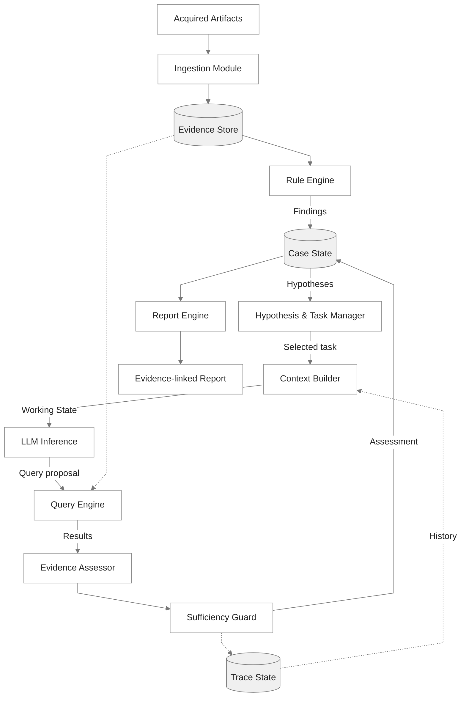

# FORENSIA


[日本語](README-ja.md)

FORENSIA is an experimental harness for LLM-assisted Windows digital forensics.

It ingests artifacts such as MFT, EVTX, Prefetch, and Registry data, then uses findings from detection rules to begin a cycle of **forming hypotheses, searching and testing evidence, and updating a report**.

The project explores an architecture that lets **even a limited LLM carry out a forensic investigation autonomously while keeping its work consistent**.

## Background

For some mysterious reason, incident investigation requests tend to arrive on **Fridays**. Or just before a long holiday.\
Whatever trip you were planning for the weekend is beside the point.

You could work through the weekend, day and night, and perhaps deliver results sooner. But is that really what needs to happen right now?

Incident response does not end with the investigation. Nor does everything else have to wait until the investigation is finished.\
While you focus on the decisions that actually need your attention, is there anyone who can sort through the evidence, test hypotheses, and keep working without sleep or fatigue?

No one. Except **your AI friend**.

## Purpose

Digital forensics involves repeatedly finding relevant evidence in large datasets, forming hypotheses, and checking them against other evidence. The assumptions and investigative steps vary considerably from case to case, making this work difficult to automate with a fixed procedure.

LLMs may help with tasks that conventional deterministic programs struggle with: interpreting instructions in natural language and deciding how to investigate a developing situation. With suitable tools, an LLM might be able to keep an investigation moving without a person directing every step.

Forensic evidence, however, often contains sensitive information. Sending it to an external cloud service can introduce new risks, and is not something I would personally recommend. That makes local LLMs, which can operate in fully isolated environments, especially relevant.

Individuals and small CSIRTs also have limited computing resources. Running frontier-scale models capable of handling the whole job autonomously would require an enormous budget. The question behind this project is whether smaller models—roughly 2B to 30B parameters, running on ordinary computers—could do the work instead.

Give a small model a large body of evidence and a long investigation, and problems soon appear: lost context, repeated work, and unsupported inferences. We cannot simply hand over everything from planning to conclusions.

FORENSIA therefore asks **how far a carefully designed harness can compensate for a limited LLM, allowing it to conduct a consistent forensic investigation without constant human intervention**.

## Design Principles

Three principles guide the project.

### 1. Go it alone

An investigation should be able to continue in a fully isolated environment, without sending sensitive evidence outside it.\
Evidence storage, search, investigation state, and LLM inference are all designed to run locally.

Leave a network-connected AI system unattended for the weekend, and Monday's welcome screen might be a ransomware demand.

### 2. Don't expect too much from the LLM

The LLM proposes hypotheses, suggests ways to test them, interprets evidence, and drafts report text—tasks that are difficult to express as deterministic programs.\
The harness handles query execution, operation limits, evaluation of verification conditions, and state updates mechanically wherever possible.

The harness orchestrates the investigation on the assumption that the LLM will make mistakes and forget things.

### 3. Spend time freely

There is no need to get the right answer in a single inference. People cannot do that either.\
Start with an observation, form a hypothesis, examine the evidence, consider other explanations, and make progress a little at a time.

But spending more time means nothing if it only produces the same failures over and over.

FORENSIA records what it examined, what it learned, and where it failed, so that later work can use those results. Progress, the ability to test remaining hypotheses, and execution budgets determine when to continue and when to stop.

## Architecture

At the center of FORENSIA is an investigation loop that repeatedly forms hypotheses and tests them against evidence.

In a typical AI agent, the model selects an action and adds the tool's result to its conversation history before taking the next step. Conversation history alone is not enough for a forensic investigation.\
Earlier reasoning may be wrong. A search that finds no evidence does not necessarily disprove a hypothesis. As work continues, the model may also lose track of what has already been tested and what remains unresolved.

FORENSIA manages investigation state separately from the LLM's conversation history. Plans, evidence, the basis for decisions, and past attempts are stored outside the model. Only the information needed for the current task is selected and passed to it.\
The design builds on the execution loop of coding agents, incorporating separation of planning and execution, persistent tasks, and shared search history to support long investigations.

The following diagram shows the main responsibilities and the data exchanged between them.



### 1. Findings as a starting point

If an investigation starts entirely from the LLM's own knowledge, gaps in that knowledge or faulty reasoning can affect everything that follows.\
FORENSIA instead applies Sigma and its own forensic rules to the ingested artifacts, extracting observations that can serve as investigative leads.

A rule match is not necessarily proof of compromise. Findings lead to hypotheses, which are checked against evidence as the investigation narrows or expands its scope.

### 2. Memory that keeps the investigation consistent

Conversation history alone cannot reliably preserve what has been examined, what remains unverified, and why a conclusion was reached.\
FORENSIA distinguishes and links Evidence, Findings, Hypotheses, Tasks, Gaps, and Claims.

It also separates investigative memory into three kinds of state.

| State | Role |
|---|---|
| **Case State** | Evidence references, findings, hypotheses, verification results, and unresolved work |
| **Trace State** | The history of searches, reasoning, failures, and state transitions |
| **Working State** | Temporary context assembled for the current task |

Case State and Trace State are stored outside the LLM. Working State is assembled for each task.\
This avoids sending all the evidence and previous conversations to the model every time, while retaining references to the underlying evidence and execution history.

### 3. Separating planning from verification

An LLM can become so focused on the immediate task that it loses sight of the original objective or unresolved questions. People do this too.\
FORENSIA persists hypotheses and tasks, and uses a planner to select the next piece of work based on priorities and dependencies.

The LLM receives only the context needed for that work and proposes search strategies, queries, and interpretations. The harness controls validation and execution of those queries.\
Separating overall planning from individual verification steps is intended to let a single small model work toward the investigation's objective without losing track of progress.

### 4. Conclusions grounded in evidence

A plausible explanation from an LLM is not necessarily a correct conclusion.\
The model's judgment of a search result is treated as a proposal. The harness checks its relationship to the actual evidence and whether the verification conditions have been met.

For example, a query returning zero rows cannot establish that an activity never occurred if the required logs were not collected.\
FORENSIA considers evidence sufficiency, independence, contradictions, and scope, with an emphasis on leaving inadequately tested claims unresolved.

Even when a report contains questionable reasoning, **a person must be able to trace the decision back to its evidence and assess whether it holds up**.

### 5. Managing continuation and termination

Repeating the same searches and failures does not make an investigation more useful.

Past attempts are recorded, and progress, available verification work, and execution budgets determine whether the investigation continues.\
Unresolved questions are kept with the reasons they could not be tested and the conditions for retrying them. New evidence can then support resuming that work.

A forensic investigation rarely resolves every question. Even with incomplete information, the aim is to **develop hypotheses supported by evidence and make clear what has been established and what remains unresolved**.

## Usage

### Quick Start

FORENSIA requires acquired Windows artifacts and an OpenAI-compatible LLM backend.\
The development environment uses Python 3.14 or later and [uv](https://docs.astral.sh/uv/).

```bash
$ git clone https://github.com/sumeshi/forensia
$ cd forensia
$ uv sync --locked
$ uv run forensia setup
$ cp .env.example .env
```

Set the backend URL and model ID in `.env`.

```dotenv
LLM_BASE_URL=http://127.0.0.1:8080
LLM_MODEL=your-loaded-model-id
FORENSIA_OUTPUT_LANGUAGE=en
```

Use the server's root URL for `LLM_BASE_URL`, without `/v1`.

With a locally hosted LLM, the investigation can run without sending evidence-derived data outside the machine.\
If you configure an external endpoint, evidence-derived information included in prompts will be sent to it.

Place the acquired artifacts in `./input`, then start an investigation.

```bash
$ uv run forensia investigate ./input --out ./CASE001-WINDESKTOP-FOOBAR
```

See `--help` for other options.

`setup` downloads a pinned SigmaHQ revision, converts and validates it, and stores the rules locally. The first investigation also runs setup if needed. To use local Sigma YAML instead, pass `--rules ./rules` (a file or directory); `setup --rules ./rules` installs it as the default. Once installed, rule loading needs no network access. Each case retains its adopted rules for subsequent runs.

To start over in the same output location for testing, use `--overwrite`. This deletes the entire case directory and reingests the original artifacts. Keep originals and any configuration documents you want to reuse outside the case directory, and stop the investigation before using it.

In the TUI, `/quit` or `Ctrl+Q` also shuts down the investigation process. Use `/kill` to force termination while stopping, or `/detach` to close the screen while the investigation continues. Forced termination interrupts unfinished work.

## Limitations and Evaluation

FORENSIA is experimental.\
Investigation results and reports may contain errors and require human review against the original evidence.

The project uses repeated benchmarks with the [CFReDS Data Leakage Case](https://cfreds-archive.nist.gov/data_leakage_case/data-leakage-case.html) to evaluate investigative capability and quality, and to improve the architecture.\
Evaluation covers more than whether the final answers are correct: it also examines the validity of hypotheses, incorrect judgments caused by missing evidence, continuity of investigation state, redundant attempts, inference counts, and execution time.

## References

The project builds on the following work.

- [Do Local LLMs Dream of Forensic Investigators?](https://sumeshi.github.io/posts/works/do-localllms-dream-of-forensic-investigator) (Japanese) — Project background and design philosophy
- `*2es` — Parsing and normalization of Windows artifacts
  - [evtx2es](https://github.com/sumeshi/evtx2es)
  - [mft2es](https://github.com/sumeshi/mft2es)
  - [prefetch2es](https://github.com/sumeshi/prefetch2es)
  - [reg2es](https://github.com/sumeshi/reg2es)

FORENSIA uses these open source projects.

- [DuckDB](https://duckdb.org/) — Evidence queries and investigation state storage
- [Sigma](https://github.com/SigmaHQ/sigma) — Detection rules that provide investigative leads

Its design is also influenced by these projects.

- [Pi](https://github.com/earendil-works/pi) — Agent execution loops and context management
- [ARTEX](https://github.com/mhtsec/ARTEX) — Separation of planning and execution, persistent tasks, and shared search history

## Contributing

FORENSIA is under active development. Its architecture and interfaces may change substantially.
Contributions and discussion are welcome, including ways to simplify the harness, examples of failed investigations, and methods for measuring reasoning and verification quality.

See [CONTRIBUTING.md](CONTRIBUTING.md) (currently in Japanese) for the implementation's design decisions, processing flow, and development essentials.

## License

The software is available under the [MIT License](LICENSE).
SigmaHQ rules are acquired separately under the [Detection Rule License 1.1](https://github.com/SigmaHQ/Detection-Rule-License). Reports retain the supplied rule authors and sources. Upstream regression data in `tests/fixtures/sigma/` is excluded from Python distributions and retains its own license.
