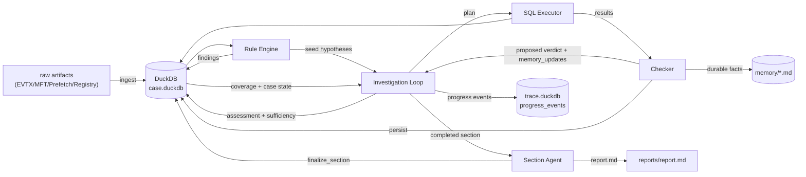
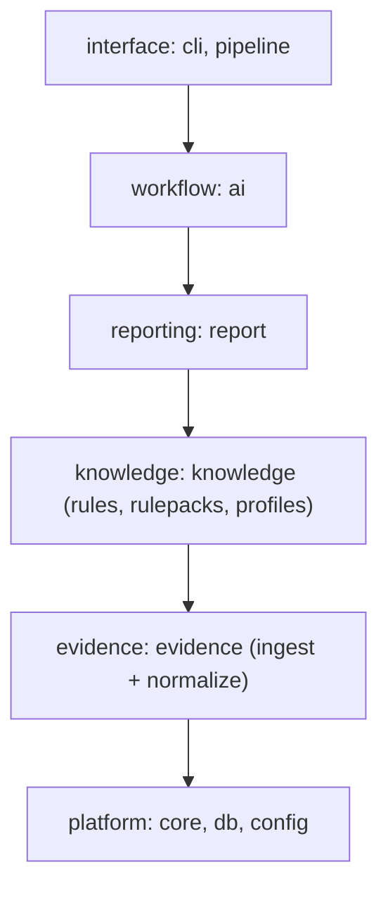
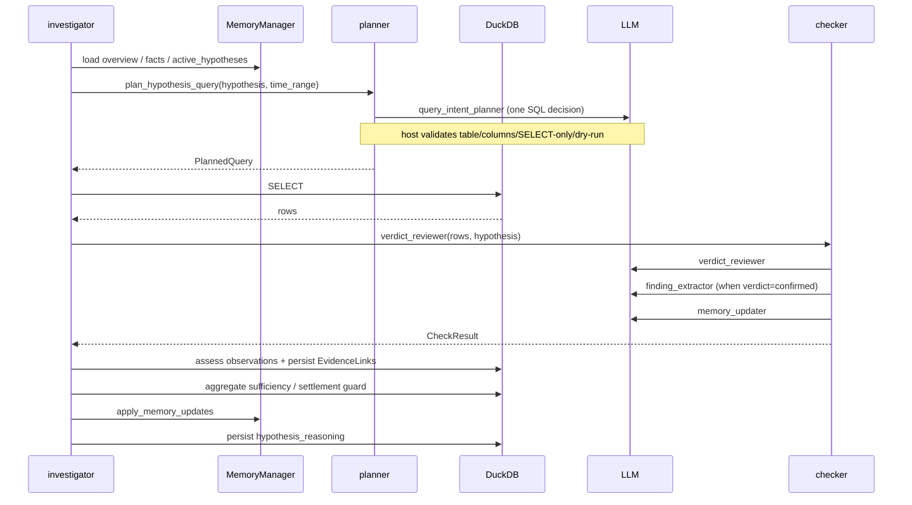
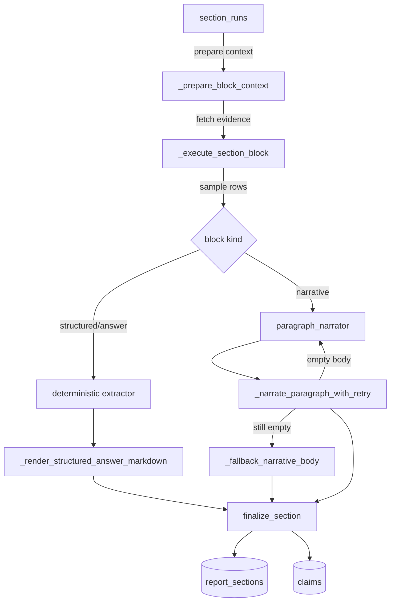

# Architecture

Overview of the current implementation of forensia. It objectively describes data flow and responsibility separation. When you change code, update this document in the same PR.

Details are split into separate documents:
- Data definitions → [data-model.md](data-model.md)
- File-level responsibilities → [code-map.md](code-map.md)
- LLM role specification → [llm-roles.md](llm-roles.md)

---

## 0. Kernel entry (V2-02)

One display-agnostic run entry ([src/forensia/pipeline.py](../src/forensia/pipeline.py))
owns the stage assembly that used to live in `cli/`: case open/init, `--rerun`
reset, knowledge indexing, ingest → normalize → analyze → `investigator.investigate`
→ report render, plus `CaseTasks` bookkeeping and the trace-DB progress pusher.
It introduces no planner, no service layer, and no stage state of its own: the
engines below own their stages, and `run_investigation` only wires them.

Contract for adapters (the headless CLI today, the TUI later — GOAL §6.3):

- typed signature: `run_investigation(case_dir, *, input_dir, profile,
  llm_base_url, model, template_dir, knowledge_dir, rerun, report_only,
  max_iter, max_queries_per_hypothesis, no_progress_limit, report_every_n_cycles,
  report_max_queries_per_section, max_llm_calls, auto_rulepacks, timezone,
  status, pre_investigation) -> Path` (the rendered report path);
- imports of the entry and the kernel pull no typer/rich (and no httpx until an
  LLM call is actually attempted); `core/log.log` prints plain text, so terminal
  rendering belongs to the adapter;
- user-facing argument problems raise `UsageError` (a `ValueError`); adapters
  translate it into their own parameter-error rendering; dataset errors such as
  `LLMServerUnavailableError` propagate (the CLI prints the abort line followed
  by exit code 2);
- plain status lines flow through the injected `status` callback;
  `pre_investigation` is the adapter hook that renders profile/timezone advice
  between the evidence stages and the loop (CLI renders them; a TUI can decide
  later);
- structured progress is recorded in the trace DB through `db/progress.py`
  (one row per emit, capped at 1000 rows — a bounded recent view); audit
  receipts stay in the trace tables and are not replaced by that view;
- SIGINT capture and stop application stay in `investigator.investigate`
  (signal → `ctx.interrupted` flag → `stopped` classification), and the session
  terminal receipt is persisted before fallible projections (`investigator.py`
  `finally` block): a run interrupted or stopped without any UI still finalizes
  its session, stop reason, and report. The receipt always carries a structured
  `terminal_reason`, and startup crash recovery
  (`reconcile_stale_sessions`) only abandons an expired `running` lease — it
  never rewrites the reasons of past terminal rows (V2-04/R07). The Case stop
  state is written only by real investigation stops, before the final report
  render; a report-only run is a report job, so it never rewrites the Case stop
  state and an unresolved Case with open Gaps/Tasks stays resumable afterwards.

---

## 1. Pipeline overview



Registry hives enter through the same artifact adapter dispatch as EVTX, MFT,
and Prefetch. `evidence/registry.py` detects `REGF` content, treats directory
layout as a grouping candidate only, and keeps unattributed primaries separate.
`.LOG`/`.LOG1`/`.LOG2` files are admitted only as non-empty companions to a matching
primary; they are not standalone datasets. The adapter streams the pinned `reg2es`
generator output to raw JSONL. The Registry normalization boundary projects
lossless records, contributor provenance, conservative completeness, and
Coverage through the existing normalize/coverage dispatchers.
For content replacement, an unattributed dataset may supersede only an older
unattributed dataset with the same complete set of operational member paths.
Those paths establish replacement lineage only; they never establish dataset
identity or group directory neighbors.

The existing SQL schema-card/allow-list exposes `registry_artifacts` and
`registry_timeline`; `registry-<sha256>` IDs use the generic evidence lookup
and report evidence map. Valid Registry timestamps are fed into the existing
`case_timeline` table. Coverage remains partial when plugin completeness is
unproven, so an empty Registry result is not treated as a refutation.

LLM working Memory is a bounded projection, not another evidence authority. Finding
cards are selected round-robin across the existing report finding themes and retain
individual finding/evidence IDs plus theme drill-down IDs. Scope cards rank all observed
host/time candidates and never delete or hide authoritative evidence.

Entry points:
- User perspective: `forensia investigate <case> <input_dir>` ([src/forensia/cli/app.py](../src/forensia/cli/app.py)), a thin adapter over
- Internal implementation: `run_investigation(...)` ([src/forensia/pipeline.py](../src/forensia/pipeline.py)), which calls `await investigate(...)` ([src/forensia/ai/investigation/investigator.py](../src/forensia/ai/investigation/investigator.py))

---

Cases use the latest-only `SCHEMA_VERSION` contract in each DuckDB database.
Startup creates the full current schema for a new case; reopening current cases
does not run migrations or repair verdicts. Unsupported or incomplete case DB pairs
are rejected without persistent writes; the original artifacts can be ingested into
a new directory. See [development.md](development.md#43-latest-only-case-schema).

Investigation passes an immutable `CaseEvidenceProfile` projection explicitly through
cycle, runner and prompt builders. Its profile name is the selected rule profile,
its summary/event IDs derive from the current DB, and it has no module-global state
or path-keyed cache. Standalone report and Settlement availability reads use their
own case DB, so another investigation cannot contaminate them.

## 2. Data flow per stage

### 2.1 Ingest

Input: EVTX / MFT / Prefetch / Registry hives under `raw/`
Output: DuckDB normalized evidence and timeline tables

| Input | Parser | Output table |
|---|---|---|
| `*.evtx` | `evtx2es` → JSONL | `evtx_events` |
| `$MFT` | `mft2es` → entries JSONL | `mft_entries` + derived `mft_timeline` (single path: timeline rows are expanded in DuckDB; standalone `mft-timeline-*.jsonl` inputs are no longer read and leftover files are left untouched) |
| `*.pf` | `prefetch2es` → JSONL | `prefetch_executions` + `prefetch_timeline` |
| REGF primary hive (+ matching `.LOG1`/`.LOG2`) | `reg2es` → JSONL | `registry_artifacts` + `registry_timeline` |

Each row carries an `evidence_id`, which is the identifier that ties evidence together across the entire pipeline (see [data-model.md](data-model.md#11-normalized-evidence-data) for the naming convention).

`ingest_all` passes the hash keys of newly generated JSONL files to
`normalize_all`. Normalization therefore replaces only added/updated sources;
calling `normalize_all` without keys remains the explicit full-rebuild path.
Artifact replacement uses set-based `INSERT ... SELECT` inside a transaction.
MFT timeline rows are expanded from the eight normalized entry timestamps in
DuckDB, avoiding a second parser pass and duplicate timeline JSONL.

Normalized rows carry the ingest SHA-256 as their durable `source_file`
identity: the adapter parsers take it as a required argument, and source
status, Coverage, and link currentness all read the same value. Source-status
lookup no longer probes path variants; sources whose normalized rows were
written under an older path identity report `failed`/`empty` instead of being
silently re-matched, and re-ingest is the supported correction.

Around each successful adapter replacement, `normalize_all` compares only
evidence IDs already referenced by Hypotheses, Claims, or report sections. If a
referenced ID disappears or its content changes, its assessed EvidenceLink
remains as history while the Hypothesis reopens as active with sufficiency
marked `needs_review`, the Claim moves to review, and the affected section
becomes stale. A reopened Hypothesis is eligible for a new investigation
attempt rather than stranded outside candidate selection.
Unchanged IDs do not trigger invalidation; large evidence tables are not copied
into an in-memory snapshot.

At ingest completion, `case.extract_time_range(db.conn)` stores the MIN/MAX timestamp from `evtx_events` into `case._time_range_*`, which is later passed to SQL generation prompts.

### 2.2 Dependency layers

Dependencies point downward in this order; a lower layer must not import a
higher layer:



`scripts/check_imports.py` enforces this direction and rejects stale exception
entries. It currently has no exception. Do not add an exception without
documenting why the responsibility cannot move to the higher layer.

Placement decision:

1. Command handling and the display adapter go in `cli/`.
2. The display-agnostic run entry (`pipeline.py`) sits beside `cli/` in the
   interface layer so adapters may call it and kernel layers may not import it.
3. Investigation orchestration and LLM loops go in `ai/`.
4. Report evidence selection, section lifecycle, or rendering goes in the
   corresponding `report/answers`, `report/sections`, or `report/render` family.
5. Declarative forensic vocabulary and readers go in `knowledge/rulepacks/`, `knowledge/rules/`, or
   `knowledge/`.
6. Artifact parsing/loading goes in `evidence/` (per-artifact module with ingest + normalize halves).
7. Reusable storage, DTO, configuration, and case primitives go in the platform
   packages only when they do not depend on workflow behavior.

### 2.3 Rule Engine

Input: normalized tables + YAML under [src/forensia/knowledge/rulepacks/](../src/forensia/knowledge/rulepacks/)
Output: `findings` table

Each rule yaml declares `query` (SQL), `finding` (template), `attack` (MITRE), `hypotheses` (verification types), and `fallback_search` (alternative when 0 rows).

```yaml
# Example: windows-security-4624-logon
attack:
  - tactic: initial-access
    technique_id: T1078
    technique_name: Valid Accounts
query: |
  SELECT evidence_id, timestamp, computer, target_user, logon_type
  FROM evtx_events
  WHERE event_id = 4624 AND logon_type IN ('2','10')
```

The engine runs the SQL, fills the `finding` template with the rows, and INSERTs into `findings`. The `attack` field is kept as a JSON string on the finding row; the Web-only tactic × technique matrix aggregation consumed it and was removed together with the Web layer.

### 2.4 Investigation Loop

The main loop in [ai/investigator.py](../src/forensia/ai/investigation/investigator.py) (cycle body in [ai/investigation_cycle.py](../src/forensia/ai/investigation/investigation_cycle.py)) combines deterministic case-state selection with the existing plan/execute/check/report stages.



Main stages:

1. **broad_plan**: `gap_identifier` extracts uncovered observation points, and `hypothesis_drafter` drafts a hypothesis per gap
2. **select**: `selection.py` filters blocked/unobservable/exhausted candidates and ranks eligible hypotheses from deterministic priority components. Eligibility is read from the shared work judgment (`work_judgment.judge_work` with the candidate-flow gates): the same read backs stop classification and reopen. Required capabilities come from the shared derivation owner `derive_required_capabilities` / `spec_capabilities` (`knowledge/coverage.py`, `ai/investigation/work_judgment.py`): a declared `required_capabilities` list on the canonical VerificationSpec wins, otherwise structured event IDs in its support conditions map through the existing artifact capability catalog. The score keeps admitted-work references, evidence severity/availability, objective token relevance, relation structure, aging, execution cost, and the repetition penalties; report-prose, section-confidence, and staleness terms were removed so a report reword cannot change the investigation order. The full score breakdown is stored in Trace. CaseDB initializes the required schema; selection errors propagate to the investigation's failed terminal receipt instead of invoking a second selector that bypasses eligibility.
3. **plan**: The query-intent kernel validates a small typed action menu: the initial phase permits `memory.read_more` or `sql.query`, while the post-expansion phase permits only `sql.query`. One LLM decision selects a parameterized recipe or bounded fallback SQL. The host then checks schema/table eligibility, SELECT-only policy, limits and dry-run deterministically; there is no LLM schema-readiness or second SQL-composer call. The normalized nested action is the sole query source; the original wrapper is retained for audit. A host-rejected action records a planner-validation reason and gets one bounded repair opportunity through the next planner prompt before the hypothesis is stopped.
4. **execute/check**: Issues a safe SELECT, applies fallback behavior and obtains the Checker's proposed verdict. The existing hypothesis SQL execution records a versioned `ToolReceipt` and one-attempt `RetrievalEvaluation` inside the same `trace.investigation_steps.output_json`; the receipt records query/provenance/result observations only and does not assign Evidence roles or consume checker verdicts. Planner-only validation failures are not execution progress and cannot substitute for `do`/`check` receipts.
5. **assessment/sufficiency/settlement**: `assess_evidence_group` classifies each adequate observation group from `VerificationSpec`, observation fields and provenance; it never reads the checker verdict, and the query ID is acquisition history only — the derivation root is the observed content (a declared derivation group, or the evidence row itself). Sufficiency groups assessed links by that root (`derivation_root_key`), so the same evidence re-fetched under a different query is one group and cannot inflate independent support; declared groups still keep their same-root conservatism. Sufficiency ignores legacy links without an assessment ID, and Settlement does not pass through checker `refuted` / `untestable` proposals without an assessed contradiction or an explicit observable/unavailable auto condition. Support counting further distinguishes historical from currently-usable links through the shared read-time predicate `evidence_link_currentness`: a link whose evidence row was removed, whose source identity is unverifiable, or whose recorded `content_fingerprint` no longer matches the materialized row is excluded from sufficiency scoring, settlement gates, and the confirmed invariant, while the `hypothesis_evidence` row itself is kept (never deleted) as history. Each link also carries the judgment grounds of its one deterministic Assessment (`assessment_reason`, `matched_conditions`), so a past judgment stays explainable via existing IDs even after the observed rows are re-normalized away; re-evaluation adds a new link with a new assessment ID instead of overwriting the old one (V2-04/R08).
For absence-based refutation, `sql_absence_scope` certifies only a direct,
case-wide EVTX lookup of exactly the Spec's event IDs, with column projections,
no narrowing predicates, sampling, joins, derived rows or offset. Ordinary
positive row limits are allowed. The runner passes this scope to the stored
RetrievalEvaluation; the settlement gate also requires observable emptiness,
all required EVTX capabilities available, and a rule-declared zero-row refute
condition. Coverage does not certify host/time completeness; narrower or
unrepresented scopes remain unknown. Positive retrievals still use Assessment.

New evidence links capture source identity from normalized Evidence even when
SQL does not project it. Historical blank-source links are not backfilled at
read time. Registry IDs are content-derived and need only existence. Same-ID,
same-source content changes and Spec/policy changes are not yet invalidated;
T04 remains partial.

6. **relate/resolve**: Checker-derived hypotheses receive validated parent edges. Verdict effects unblock, block or flag adjacent hypotheses without changing them to an incompatible status.
7. **report/gaps**: Refreshes Claims and sections, synchronizes normalized Gap/Task lifecycle, and projects authoritative tasks into Markdown Memory.

On termination, active hypotheses are atomically classified as `deferred`,
`blocked`, `needs_review`, or `untestable`; none remain silently active. Each
classification creates a bidirectionally linked Gap and Task with a persisted
retry condition. A later ingest reactivates only work whose required capability
or source condition became satisfiable. The stop reason code remains stable for
automation, while classification counts are stored separately in
`investigation_state.stop_summary`.

Readiness predicates that consume required capabilities share one read-side
derivation (`work_judgment.py`, V2-03): `judge_work` answers, per work ref,
whether the work is runnable, which conditions block it and who owns each
condition, and what would reopen it, read on demand from Case State. The
shared availability rule is that a required capability is ready when any
Coverage row reports `available` or `partial`; selection eligibility, stop
classification, and reopen all apply this rule, so the same work cannot flip
between readers on one Case State. What stays deliberately distinct:
eligibility additionally applies candidate-flow gates (cooldown, retry
budget, prerequisites, open external tasks) that only selection asks; stop
classification maps the same blockers to `deferred`/`blocked`/
`needs_review`/`untestable` labels plus the persisted reasoning counts; and
the retrieval-eligibility readiness is not an absence certification — whether
an empty result may support a refutation is owned by the settlement gate on
the observed retrieval scope. Open work is merged through the existing link
columns (`report_gaps.task_id`/`hypothesis_id`,
`investigation_tasks.gap_id`/`hypothesis_id`, `hypotheses.source_gap_id`)
into one read result per work ref, so a Gap plus its linked Task/Hypothesis
never counts as separate open work; an unlinked unresolved Hypothesis remains
its own ref. Write owners (stop transition, reopen writes) remain in
`work_state.py`; reopen checks the persisted
`retry_condition` rather than re-deriving it from `kind`.

For the input/output schema of each LLM role, see [llm-roles.md](llm-roles.md).

**Additional behavior:**

- **auto-rulepacks**: `resolve_active_packs` ([rules/loader.py](../src/forensia/knowledge/rules/loader.py)) automatically enables rulepacks whose `applies_when.artifact_families` match the case's evidence families. Use `--no-auto-rulepacks` for the legacy behavior. Controlled by the `auto_rulepacks` argument of `investigator.investigate`.
- **playbook budget control**: `_dfir_playbook` ([ai/prompts/prompt_playbook.py](../src/forensia/ai/prompts/prompt_playbook.py)) narrows Event ID narratives to IDs that exist in the case so they stay under the user-configurable `FORENSIA_SYSTEM_PROMPT_BUDGET_CHARS`, and drops sections in priority order when the budget is exceeded. The combined plan/check budget is independently configurable with `FORENSIA_PROMPT_BUDGET_TOKENS`; when unset it scales with the system-character budget.
- **LLM trajectory and context control**: a session-scoped telemetry sink records logical decisions, every provider attempt, its exact API request and raw provider response, deterministic work, effective token limits, prompt-section sizes and retry/error lineage in `trace.duckdb`. Request transcripts exclude transport headers/API keys but contain case evidence sent in prompts, so they remain case-local operational data. Logical calls inherit the active hypothesis/iteration scope. Prompt builders send compact indexes and selected schema/recipe/event detail. Before a known context limit is crossed—or after an explicit provider context rejection—older turns are projected into a versioned regeneratable summary while recent turns and stable evidence/action references remain available for drill-down.
- **automatic timeline assembly**: The `case_timeline` table ([db/schema.py](../src/forensia/db/schema.py)) is deterministically fed with the first-evidence timestamp of findings (severity ≥ medium) and the decisive query row of resolved hypotheses (`feed_findings_to_timeline` in [rules/engine.py](../src/forensia/knowledge/rules/engine.py)). `memory/timeline.md` is a projection regenerated from this table.
- **timezone support**: `infer_timezone` ([normalize/timezone.py](../src/forensia/evidence/timezone.py)) infers the offset from events such as 4616 system time changes. It is stored in `case.source_timezone` ([core/case.py](../src/forensia/core/case.py)), and `_render_timestamp_with_timezone` ([report/render/markdown.py](../src/forensia/report/render/markdown.py)) renders a dual UTC + local display.

### 2.4 Section Agent (report generation)

Input: `findings` + `hypothesis_reasoning` + `section_facts` + `memory/*.md` + REPORT_KEYPOINTS
Output: `report_sections` + `claims` + `section_evidence` + `report.md`



Per-block processing:
- **structured**: Routed by the question template (`question_routing.yaml`) and executes SQL / builder / extraction logic deterministically. Output is a tabular Markdown + JSON/CSV export
- **narrative**: `section_outliner` fixes the layout → `paragraph_narrator` generates one paragraph → if the body is empty it retries once with a coaching turn → if still empty, `_fallback_narrative_body` generates it locally

For narrative evidence gathering, each block persists its plan/query/check runs.
The next iteration receives the latest runs, including the checker's
`missing_questions`; those unresolved questions are also added to external
knowledge retrieval terms. This makes retrieval progressively narrower instead
of repeating the section title on every pass. System and combined-message limits
follow the configured prompt budgets, preserving the task/schema, recent trace
tail, and selected reference
snippets while compacting broad catalogs and oversized dynamic data.

Hypothesis memory uses a hierarchical, scope-tagged index for progressive
disclosure. Core confirmed memory and relevant entity/keypoint cards are loaded
first; the current hypothesis card/scratch can be requested by exact path. Other
hypothesis scratch/history is excluded both from the index and by a loader-side
allow-list. Memory-index, `read_more`, and report knowledge selections emit
observational rows to the separate `trace.duckdb`; this telemetry never feeds
ranking automatically. The `read_more` loader also reports its actual scope
decision and one-attempt retrieval evaluation to its existing callback; it does
not create a second receipt store.

The final Markdown is assembled by `build_report_markdown_from_db` ([report/render/writer.py](../src/forensia/report/render/writer.py)) from `report_sections`, and `_strip_narrative_status_lines` ([report/sections/section_quality.py](../src/forensia/report/sections/section_quality.py)) strips internal metadata (such as `**Status:**` lines) from non-appendix sections. `derive_publication_state` ([report/report_validation.py](../src/forensia/report/report_validation.py)) separately checks confirmed hypotheses, hypothesis `do`/`check` receipts, evidence links, and draft sections. When those prerequisites are incomplete, report prompts and the rendered report are explicitly constrained to deterministic signals/review candidates and carry a reader-visible `needs_review` / `incomplete` notice; section workflow status is not treated as evidence confidence.

Hypothesis SQL receipts reuse the existing `query_fingerprint`, Coverage
projection, planner validation/dry-run observations, fallback behavior, and
`_save_step` persistence. Empty results remain observations: retrieval
evaluation marks Coverage-unknown empties as partial and never turns them into
negative evidence or a verdict. Bounded fallback results retain their pre-limit
row count and truncation flag in both the checker summary and SQL receipt.

---

## 3. Report generation details

### 3.1 Section organization

Markdown templates under `report_template_dir` declare the layout per `section_key`. The standard set is:

```
1_overview        · Executive Summary, Classification, Scope, Impact, Key Findings, Conclusion
2_timeline        · Time Basis, Log Integrity, Phase Summary, Chronological Events
3_technical       · Incident Progression, Systems/Accounts, Execution, Network, Files, Antiforensics
4_gaps            · Limitations, Unresolved/Untestable Hypotheses, Evidence Gaps, Follow-up
5_recommendations · Containment, Action Plan, Eradication/Recovery, Risk Reduction, Residual Risk
```

The bundled generic report intentionally ends at section 5. `6_appendix` is an
optional external-template convention used by the benchmark to render structured
questions; it is not copied into ordinary cases or exported with bundled defaults.

Each section is decomposed into multiple **blocks** (heading units) and processed sequentially by `run_section_block_agent` ([ai/sections/section_agent.py](../src/forensia/ai/sections/section_agent.py)).

### 3.2 Keypoint catalog

`REPORT_KEYPOINTS` ([report/answers/keypoint_catalog.py](../src/forensia/report/answers/keypoint_catalog.py)) registers "predefined queries available to a section" as a mapping. Each entry is a `(label, resolver)` pair where `resolver(db) → list[dict]`. Representative examples:

- `overview_top_findings` — high/critical findings sorted by confidence
- `overview_hosts` — `evtx_events.computer` aggregation
- `host_execution_activity` — 4688 + 1059 family
- `host_persistence_activity` — 4697 / 4698 / 7045 / 13
- `account_logon_patterns` — 4624/4625/4634/4647
- `unresolved_hypotheses_summary` — list of hypotheses whose verdict is not yet settled
- `recommendations_findings` — all findings sorted by severity
- `appendix_findings_catalog` — full catalog for the appendix

`_default_keypoints_for_section` ([report/answers/keypoint_catalog.py](../src/forensia/report/answers/keypoint_catalog.py)) selects a keypoint by section_key prefix and block-heading keywords.

### 3.3 Structured Answer

When an external template set defines `6_appendix`, each question in that section
is processed as a structured answer.

| Step | Location |
|---|---|
| Question template definition | `src/forensia/knowledge/rulepacks/_schema/question_routing.yaml` |
| answer_spec → builder routing | `questions.resolve_question_spec` |
| SQL execution / extractor call | `ai/sections/section_answers.py` (`_format_structured_answer`) |
| Markdown rendering | `report/answers/answer_store.py` (`_render_structured_answer_markdown`) |
| JSON / CSV export | `report/answers/answer_store.py` (`_persist_structured_answer` → `reports/structured/`) |

Status is one of `answered` / `partial` / `not_found` / `not_searched` / `wrong_query` / `insufficient_evidence`. `### Missing Reason` is omitted when status=answered and the result is effectively empty (`[]` / `["none"]` / `["no match"]` etc).

---

## 4. Progress persistence and runtime visibility

There is no server or UI projection store. Structured progress emitted during
an investigation is persisted durably in the trace database: the DB-layer
progress module ([src/forensia/db/progress.py](../src/forensia/db/progress.py))
appends one row per emit to `trace.progress_events`, keeping the most recent
1000 events (oldest rows are pruned). Each row carries the stage/status/state,
iteration, current query, a short summary, and the raw payload; the CLI surfaces recent progress lines directly from this table.

`reports/` contains only report artifacts: `report.md`, `report.html`,
`report_brief.json`, per-section debug/evidence dumps, and the structured
CSV/JSON export. There are no `reports/api/*.json` snapshot files.

---

## 5. Case directory structure

```
dist/<case>/
├─ raw/                 · Parsed artifact records (JSONL) staged during ingest
├─ db/case.duckdb       · Normalized tables + hypotheses + findings + report_sections
├─ memory/              · LLM persistent memory (overview.md, facts.md, entities/, hypotheses/, scratch/)
├─ ai_logs/             · Raw LLM input/output logs (per-phase JSON, for debugging)
├─ reports/
│  ├─ report.md         · Final report Markdown
│  ├─ report.html       · Same content as HTML
│  ├─ report_brief.json · Structured summary for LLM context
│  ├─ debug/            · Per-section trace dumps
│  ├─ evidence/*.json   · Raw evidence per section
│  └─ structured/*.csv  · CSV export of structured answers
├─ findings/            · Per-rule finding details
├─ allowlist.yaml       · Finding identifiers to suppress
├─ manifest.yaml        · Case metadata
└─ report_template/     · Project-specific templates (optional)
```

---

## 6. Configuration

Configuration is loaded once through `src/forensia/config.py` and refreshed in place
when requested. `.env` is loaded by `python-dotenv`; CLI endpoint/model/query-budget
flags take precedence. The complete environment-variable contract, defaults, automatic
budget derivation, and runtime owners live in [development.md](development.md#11-python)
to avoid maintaining a second partial table here.

### Report admission and semantic progress

Report gaps are admission requests represented by the existing `report_gaps`
row. `investigation_tasks` carries ownership and retry state for non-hypothesis
work. Admission links equivalent existing work first, then validates a
normalized `VerificationSpec` before persisting a new Hypothesis. Report
content cannot set priority or verdict. A request string leaving the report
prose is an editorial change, not a resolution: similarity or membership in
the same section cannot close admitted work. The Gap stays open, annotated
with `coverage_reason='report_request_absent'` if no specific reason exists,
and a linked
`untestable` hypothesis keeps the Gap open rather than completing acquisition.
Termination observes durable Gap/Task/Hypothesis lifecycle, assessed evidence,
contradiction, and Coverage changes; body length and formatting are not
progress. Progress and re-evaluation are compared by `report_cycle_progress`
between `evaluation_snapshot` reads taken at the loop's state-commit point
(after the cycle's Coverage refresh): new unresolved work refs, new assessed
observation roots (same-root refetch collapses to the same root), new
unhandled contradiction roots, and source/Coverage identity changes —
including same-count source replacements and Coverage downgrades — count;
prose growth, uninformative queries, and status round-trips that leave the
same refs do not. The completion gate counts durable open work refs instead
of the report prose `total_gaps`, so a section reword cannot report a session
as completed while admitted work is open.
